# 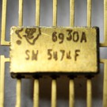 Project 54/74

This project seeks to document 54xx/74xx-series logic chips and subfamilies by imaging and annotating their dies and tracing out their schematics.
These chips usually have no more than 100 transistors, making them easy to understand.

**Original website by Robert C. Baruch, 2016-2021**  

All chips were decapsulated, photographed, and, if applicable, traced by Robert C. Baruch, unless specified otherwise.

**Revived by Ivo van Poorten, 2026-**  

Almost everything has been found by using archive.org, siliconpr0n.org scrape tarball, Wikimedia Commons, and Google search.
See [missing.txt](missing.txt) for what's still missing.
Image thumbnails link to (very) large images hosted by Wikimedia Commons.
All manually collected datasheets, KiCad projects, schematic PDFs, and SVG trace files are hosted locally.

SVG files have been stripped of their embedded die images to keep their file size low.
The layers are still there and reference ./image1.jpg (and ./image2.jpg if there's a delayered die image layer).
You can manually download the corresponding files from Wikimedia, rename them, and place them in the same directory as the SVG file.

I have tried contacting Robert Baruch directly, but I received no response.
Seeing all his websites disappeared and no updates on YouTube for years made me a bit sad.
This repo makes it easy again to browse all his work in one place.

___
## Devices

[00](#00) [01](#01) [02](#02) [03](#03) [04](#04) [05](#05) [06](#06) [07](#07) [08](#08) [09](#09) [10](#10) [11](#11) [13](#13) [14](#14) [20](#20) [27](#27) [28](#28) [30](#30) [32](#32) [33](#33) [37](#37) [41](#41) [42](#42) [45](#45) [60](#60) [74](#74) [76](#76) [81](#81) [90](#90) [95](#95) [116](#116) [123](#123) [125](#125) [141](#141) [148](#148) [150](#150) [157](#157) [163](#163) [164](#164) [166](#166) [170](#170) [175](#175) [189](#189) [219](#219) [221](#221) [240](#240) [244](#244) [245](#245) [253](#253) [257](#257) [273](#273) [274](#274) [283](#283) [362](#362) [373](#373) [390](#390) [592](#592) [688](#688) [867](#867) [942](#942)

___
### 00
( quad 2-input NAND gate )

___
| | 5400 |
|---|---|
| Manufacturer | National Semiconductor |
| Date Code | 8020 |
| Decap Date | 2017-03-04 |
| Transistor Count | 16 |
| Package | Ceramic |
| Top Markings | [Logo] 8020 / DM5400J/8838 |
| Bottom Markings | 3A |
| Images | [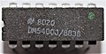](https://upload.wikimedia.org/wikipedia/commons/6/6c/Dm5400j-pack_top.jpg) [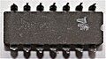](https://upload.wikimedia.org/wikipedia/commons/7/7e/Dm5400j-pack_bottom.jpg)  [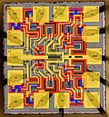](https://upload.wikimedia.org/wikipedia/commons/0/08/National_semiconductor_dm5400j_8838_die_image_annotated.jpg) [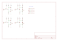](https://upload.wikimedia.org/wikipedia/commons/c/cb/5400_NS_8838_schematic.png) |
| Files | [KiCad](kicad/5400%20NS%208838%20schematic) [PDF](pdf/National_semiconductor_dm5400j_8838_schematic.pdf) [SVG](svg/5400%20NS%208838.svg) [datasheet](datasheet/5400_NS_datasheet.pdf) |

___
| | 5400 |
|---|---|
| Manufacturer | Texas Instruments |
| Date Code | 0421 |
| Decap Date | 2017-05-21 |
| Transistor Count | 16 |
| Package | Ceramic |
| Top Markings | 0ACS 0421A / SN5400J / THA [Logo] |
| Images | [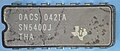](https://upload.wikimedia.org/wikipedia/commons/f/f1/5400_TI_0421_package_top.jpg) [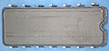](https://upload.wikimedia.org/wikipedia/commons/9/91/5400_TI_0421_package_bottom.jpg) [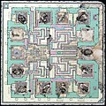](https://upload.wikimedia.org/wikipedia/commons/5/53/5400_TI_0421_die_120nmpp.jpg) [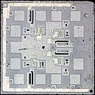](https://upload.wikimedia.org/wikipedia/commons/d/df/5400_TI_0421_delayer_120nmpp.jpg) [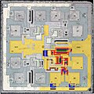](https://upload.wikimedia.org/wikipedia/commons/a/a2/5400_TI_0421_annotated_120nmpp.jpg) [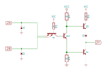](https://upload.wikimedia.org/wikipedia/commons/2/23/5400_TI_0421_schematic.png) |
| Files | [KiCad](kicad/5400%20TI%200421%20schematic) [PDF](pdf/5400_TI_0421_schematic.pdf) [SVG](svg/5400%20TI%200421%20annotated%20120nmpp.svg) [datasheet](datasheet/5400_TI_datasheet.pdf) |

___
| | 7400 |
|---|---|
| Manufacturer | National Semiconductor |
| Date Code | 443 |
| Decap Date | 2017-08-19 |
| Package | Plastic |
| Top Markings | [Logo] 443 / DM7400N |
| Bottom Markings | g |
| Images | [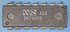](https://upload.wikimedia.org/wikipedia/commons/6/6e/7400_NS_443_package_top.jpg) [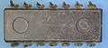](https://upload.wikimedia.org/wikipedia/commons/c/c1/7400_NS_443_package_bottom.jpg) [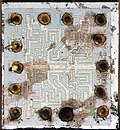](https://upload.wikimedia.org/wikipedia/commons/f/f8/7400_NS_443_die_120nmpp.jpg) |
| Files | [datasheet](datasheet/7400_NS_datasheet.pdf) |

___
| | 7400 |
|---|---|
| Manufacturer | Stewart-Warner |
| Date Code | 7413 |
| Decap Date | 2017-08-19 |
| Package | Plastic |
| Top Markings | SW 7400-N / 7413 |
| Bottom Markings | (illegible, but most likely "Philippines") |
| Images | [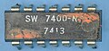](https://upload.wikimedia.org/wikipedia/commons/9/9f/7400_SW_7413_package_top.jpg) [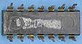](https://upload.wikimedia.org/wikipedia/commons/7/7f/7400_SW_7413_package_bottom.jpg) [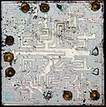](https://upload.wikimedia.org/wikipedia/commons/2/2e/7400_SW_7413_die_120nmpp.jpg) |

___
| | 54S00 |
|---|---|
| Manufacturer | Signetics |
| Date Code | 8716 |
| Decap Date | 2017-03-20 |
| Transistor Count | 20 |
| Package | Ceramic |
| Top Markings | [Logo] 54S00/ BCA / 8716 DKB THAI / [pin 1 delta marker] |
| Images | [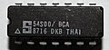](https://upload.wikimedia.org/wikipedia/commons/b/b8/54s00-pack_top.jpg) [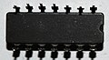](https://upload.wikimedia.org/wikipedia/commons/c/cb/54s00-pack_bottom.jpg) [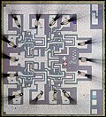](https://upload.wikimedia.org/wikipedia/commons/d/de/Signetics_54S00_8716_die_image.jpg) [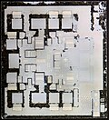](https://upload.wikimedia.org/wikipedia/commons/b/b4/Signetics_54S00_8716_die_image_delayered.jpg) [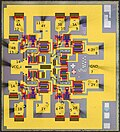](https://upload.wikimedia.org/wikipedia/commons/1/15/Signetics_54S00_8716_die_image_annotated.jpg) [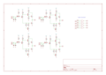](https://upload.wikimedia.org/wikipedia/commons/5/56/54S00_Signetics_8716_schematic.png) |
| Files | [KiCad](kicad/54S00%20SIG%208716%20schematic) [PDF](pdf/Schematic_for_Signetics_54S00_datecode_8716.pdf) [SVG](svg/54S00%20Signetics%208716.svg) [datasheet](datasheet/54S00_Signetics_datasheet.pdf) |

___
| | 54AS00 |
|---|---|
| Manufacturer | Texas Instruments |
| Date Code | 8747 |
| Decap Date | 2017-03-19 |
| Package | Ceramic |
| Top Markings | TAIWAN 8747 / SN54AS00J [Logo] / [Pin 1 delta marker] |
| Bottom Markings | JAX |
| Images | [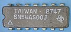](https://upload.wikimedia.org/wikipedia/commons/1/13/TI_54AS00_pack_top.jpg) [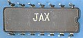](https://upload.wikimedia.org/wikipedia/commons/6/6d/TI_54AS00_pack_bottom.jpg) [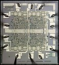](https://upload.wikimedia.org/wikipedia/commons/c/c5/Texas_Instruments_SN54AS00J_8747_die_image.jpg) [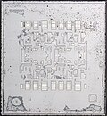](https://upload.wikimedia.org/wikipedia/commons/0/0b/54AS00_TI_8747_delayer2.jpg) [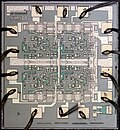](https://upload.wikimedia.org/wikipedia/commons/4/4a/Texas_Instruments_SN54AS00J_8747_die_image_minus_top_glass.jpg) |
| Files | [datasheet](datasheet/54AS00_TI_datasheet.pdf) |

___
| | 74F00 |
|---|---|
| Manufacturer | Fairchild |
| Date Code | 8423 |
| Decap Date | 2017-07-22 |
| Package | Plastic |
| Top Markings | 74F00 PC / [Logo] / 8423 USA |
| Images | [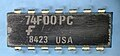](https://upload.wikimedia.org/wikipedia/commons/9/97/74F00_F_8423_package_top.jpg) [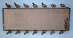](https://upload.wikimedia.org/wikipedia/commons/a/aa/74F00_F_8423_package_bottom.jpg) [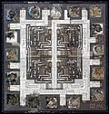](https://upload.wikimedia.org/wikipedia/commons/9/93/74F00_F_8423_die_120nmpp.jpg) [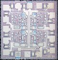](https://upload.wikimedia.org/wikipedia/commons/3/3e/74F00_F_8423_delayer_120nmpp.jpg) |
| Files | [datasheet](datasheet/74F00_Fairchild_datasheet.pdf) |

___
| | 74F00 |
|---|---|
| Manufacturer | Motorola |
| Date Code | 8352 |
| Decap Date | 2017-07-22 |
| Package | Plastic |
| Top Markings | MC74F00N / [Logo] I8352 |
| Bottom Markings | F00 KOREA / PYCJ1 |
| Images | [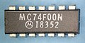](https://upload.wikimedia.org/wikipedia/commons/c/c3/74F00_Moto_8352_package_top.jpg) [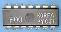](https://upload.wikimedia.org/wikipedia/commons/3/36/74F00_Moto_8352_package_bottom.jpg) [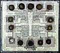](https://upload.wikimedia.org/wikipedia/commons/4/4f/74F00_Moto_8352_die_120nmpp.jpg) [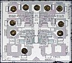](https://upload.wikimedia.org/wikipedia/commons/c/c6/74F00_Moto_8352_delayer_120nmpp.jpg) |
| Files | [datasheet](datasheet/74F00_Motorola_datasheet.pdf) |

___
| | 54HC00 |
|---|---|
| Manufacturer | National Semiconductor |
| Date Code | 8632 |
| Decap Date | 2017-10-18 |
| Package | Ceramic |
| Top Markings | [Logo] H8632[delta] / MM54HC00J/883C / 8403701CA 27104 |
| Bottom Markings | LK3/H / /J2 |
| Images | [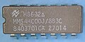](https://upload.wikimedia.org/wikipedia/commons/f/f2/54HC00_NS_8632_package_top.jpg) [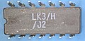](https://upload.wikimedia.org/wikipedia/commons/8/8c/54HC00_NS_8632_package_bottom.jpg) [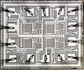](https://upload.wikimedia.org/wikipedia/commons/9/99/54HC00_NS_8632_die_120nmpp.jpg) |

___
| | 74HCT00 |
|---|---|
| Manufacturer | Radio Corporation of America |
| Date Code | 419 |
| Decap Date | 2017-08-19 |
| Package | Plastic |
| Top Markings | CD74HCT00E / RCA H 419 |
| Bottom Markings | 7AHER / B7300 |
| Images | [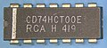](https://upload.wikimedia.org/wikipedia/commons/b/bc/74HCT00_RCA_419_package_top.jpg) [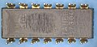](https://upload.wikimedia.org/wikipedia/commons/0/02/74HCT00_RCA_419_package_bottom.jpg) [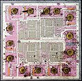](https://upload.wikimedia.org/wikipedia/commons/4/4b/74HCT00_RCA_419_die_120nmpp.jpg) |
| Files | [datasheet](datasheet/54HC00_RCA_datasheet.pdf) |

___
| | 74AC00 |
|---|---|
| Manufacturer | Fairchild |
| Date Code | 8703 |
| Decap Date | 2017-08-19 |
| Package | Plastic |
| Top Markings | 74AC00 PC / [Logo] / 8703 V SINGAPORE |
| Images | [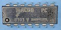](https://upload.wikimedia.org/wikipedia/commons/2/25/74AC00_F_8703_package_top.jpg) [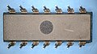](https://upload.wikimedia.org/wikipedia/commons/2/25/74AC00_F_8703_package_bottom.jpg) [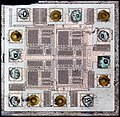](https://upload.wikimedia.org/wikipedia/commons/4/4d/74AC00_F_8703_die_120nmpp.jpg) |
| Files | [datasheet](datasheet/74AC00_Fairchild_datasheet.pdf) |

___
### 01
( quad 2-input NAND gate, open-collector )

___
| | 74LS01 |
|---|---|
| Manufacturer | Texas Instruments |
| Date Code | 8610 |
| Decap Date | 2017-04-22 |
| Transistor Count | 8 |
| Package | Plastic |
| Top Markings | [Logo] S8610BS / SN74LS01N |
| Bottom Markings | 02 / SFAM / GO |
| Images | [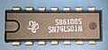](https://upload.wikimedia.org/wikipedia/commons/f/f7/74LS01_TI_8610_package_top.jpg) [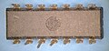](https://upload.wikimedia.org/wikipedia/commons/b/b2/74LS01_TI_8610_package_bottom.jpg) [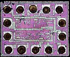](https://upload.wikimedia.org/wikipedia/commons/9/94/74LS01_TI_8610.jpg) [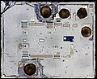](https://upload.wikimedia.org/wikipedia/commons/7/7e/74LS01_TI_8610_delayered.jpg) [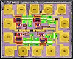](https://upload.wikimedia.org/wikipedia/commons/d/df/74LS01_TI_8610_annotated.jpg)  |
| Files | [KiCad](kicad/74LS01%20TI%208610%20schematic) [PDF](pdf/74LS01_TI_8610_schematic.pdf) [SVG](svg/74LS01%20TI%208610%20annotated.svg) [datasheet](datasheet/74LS01_TI_datasheet.pdf) |

___
### 02
( quad 2-input NOR gate )

___
| | 54S02 |
|---|---|
| Manufacturer | Texas Instruments |
| Date Code | 8341 |
| Decap Date | 2017-03-22 |
| Transistor Count | 32 |
| Package | Ceramic |
| Top Markings | TAIWAN A8341 / SNJ54S02J [Logo] / [pin 1 delta marker] 54S02/BCBJC |
| Bottom Markings | UMK |
| Images |         |
| Files | [KiCad](kicad/54S02%20TI%208341%20schematic) [PDF](pdf/54S02_TI_8341_schematic.pdf) [SVG](svg/54S02%20TI%208341.svg) [datasheet](datasheet/54S02_TI_datasheet.pdf) |

___
| | 54LS02 |
|---|---|
| Manufacturer | Texas Instruments |
| Date Code | 8410 |
| Decap Date | 2017-03-31 |
| Transistor Count | 24 |
| Package | Ceramic |
| Top Markings | TAIWAN D8410 / SNJ54LS02J [Logo] / [pin 1 delta marker] 54LS02/BCBJC |
| Bottom Markings | UAM |
| Images |       |
| Files | [KiCad](kicad/54LS02%20TI%208410%20schematic) [PDF](pdf/54LS02_TI_8410_schematic.pdf) [SVG](svg/54LS02%20TI%208410%20annotated.svg) [datasheet](datasheet/54LS02_TI_datasheet.pdf) |

___
| | 74HC02 |
|---|---|
| Manufacturer | Motorola |
| Date Code | 8302 |
| Decap Date | 2017-04-29 |
| Transistor Count | 40 |
| Package | Plastic |
| Top Markings | MC74HC02 / [Logo] N D 8302 |
| Bottom Markings | MALAYSIA / MUASQ |
| Images |       |
| Files | [KiCad](kicad/74HC02%20Motorola%208302%20schematic) [PDF](pdf/74HC02_Motorola_8302_schematic.pdf) [SVG](svg/74HC02%20Motorola%208302%20annotated.svg) [datasheet](datasheet/74HC02_Motorola_datasheet.pdf) |

___
### 03
( quad 2-input NAND gate, open-collector )

___
| | 74S03 |
|---|---|
| Manufacturer | Texas Instruments |
| Date Code | 428C |
| Decap Date | 2017-07-30 |
| Package | Plastic |
| Top Markings | EL SALVADOR 428C / [Logo] SN74S03N |
| Bottom Markings | C93 |
| Images |     |
| Files | [datasheet](datasheet/74S03_TI_datasheet.pdf) |

___
### 04
( hex inverter gate )

___
| | 5404 |
|---|---|
| Manufacturer | Texas Instruments |
| Date Code | 7426 |
| Decap Date | 2017-05-21 |
| Package | Ceramic |
| Top Markings | 7426 / [Logo] / SN5404J |
| Bottom Markings | 04AB 116W |
| Images |    |
| Files | [datasheet](datasheet/5404_TI_datasheet.pdf) |

___
| | 7404 |
|---|---|
| Manufacturer | Texas Instruments |
| Date Code | 8005 |
| Decap Date | 2017-05-13 |
| Package | Ceramic |
| Top Markings | TAIWAN 8005 / [Logo] / SN7404J |
| Bottom Markings | F5 |
| Images |    |
| Files | [datasheet](datasheet/7404_TI_datasheet.pdf) |

___
| | 74L04 |
|---|---|
| Manufacturer | Unknown |
| Date Code | 7608 |
| Decap Date | 2017-03-25 |
| Transistor Count | 24 |
| Package | Ceramic |
| Top Markings | 74L04J / 7608 |
| Images |      |
| Files | [KiCad](kicad/74L04%20UNK%207608%20schematic) [PDF](pdf/74L04_UNK_7608_schematic.pdf) [SVG](svg/74L04%20UNK%207608.svg) |

___
| | 54AS04 |
|---|---|
| Manufacturer | Texas Instruments |
| Date Code | 8737 |
| Decap Date | 2017-09-17 |
| Package | Ceramic |
| Top Markings | TAIWAN 8737 / SN54AS04J [Logo] / [pin 1 marker] |
| Bottom Markings | SLT |
| Images |    |
| Files | [datasheet](datasheet/54AS04_TI_datasheet.pdf) |

___
### 05
( hex inverter gate, open-collector )

___
| | 7405 |
|---|---|
| Manufacturer | Texas Instruments |
| Date Code | 7130 |
| Decap Date | 2017-07-30 |
| Package | Plastic |
| Top Markings | [Logo] 7130 J / SN7405N |
| Bottom Markings | 7405 |
| Images |      |
| Files | [datasheet](datasheet/7405_TI_datasheet.pdf) |

___
### 06
( hex inverter gate, open-collector )

___
| | 5406 |
|---|---|
| Manufacturer | Texas Instruments |
| Date Code | 8615 |
| Decap Date | 2017-05-06 |
| Transistor Count | 30 |
| Package | Ceramic |
| Top Markings | TAIWAN F8615 / SN5406J [Logo] / [Pin 1 Marker] |
| Bottom Markings | EIB |
| Images |       |
| Files | [KiCad](kicad/5406%20TI%208615%20schematic) [PDF](pdf/5406_TI_8615_schematic.pdf) [SVG](svg/5406%20TI%208615%20annotated.svg) [datasheet](datasheet/5406_TI_datasheet.pdf) |

___
### 07
( hex buffer gate, open-collector )

___
| | 7407 |
|---|---|
| Manufacturer | Stewart-Warner |
| Date Code | 7405 |
| Decap Date | 2017-08-13 |
| Package | Plastic |
| Top Markings | SW / 7407-N / 7405 |
| Bottom Markings | ASSY / PHILIPPINES |
| Images |    |

___
### 08
( quad 2-input AND gate )

___
| | 5408 |
|---|---|
| Manufacturer | National Semiconductor |
| Date Code | 9911 |
| Decap Date | 2017-05-21 |
| Package | Ceramic |
| Top Markings | [Logo]H6C9911BΔ / DM5408J/883 / QS |
| Bottom Markings | 03 |
| Images |    |
| Files | [datasheet](datasheet/5408_NS_datasheet.pdf) |

___
| | 74H08 |
|---|---|
| Manufacturer | National Semiconductor |
| Date Code | 411 |
| Decap Date | 2017-03-28 |
| Transistor Count | 28 |
| Package | Plastic |
| Top Markings | [Logo] 411 / DM74H08N |
| Bottom Markings | g |
| Images |      |
| Files | [KiCad](kicad/74H08%20NS%20411%20schematic) [PDF](pdf/74H08_NS_411_schematic.pdf) [SVG](svg/74H08%20NS%20411.svg) [datasheet](datasheet/74H08_NS_datasheet.pdf) |

___
| | 74LS08 |
|---|---|
| Manufacturer | Texas Instruments |
| Date Code | 8022 |
| Decap Date | 2017-05-13 |
| Transistor Count | 24 |
| Package | Ceramic |
| Top Markings | TAIWAN 8022 BG / [Logo] / 1 SN74LS08J |
| Bottom Markings | P33 |
| Images |       |
| Files | [KiCad](kicad/74LS08%20TI%208022%20schematic) [PDF](pdf/74LS08_TI_8022_schematic.pdf) [SVG](svg/74LS08%20TI%208022%20annotated%20inkscape.svg) [datasheet](datasheet/74LS08_TI_datasheet.pdf) |

___
| | 54AS08 |
|---|---|
| Manufacturer | Texas Instruments |
| Date Code | 8418 |
| Decap Date | 2017-09-17 |
| Package | Ceramic |
| Top Markings | TAIWAN 8418 / SNJ54AS08J [Logo] / [pin 1 marker]54AS08/BCAJC |
| Bottom Markings | AGN |
| Images |    |
| Files | [datasheet](datasheet/54AS08_TI_datasheet.pdf) |

___
### 09
( quad 2-input AND gate, open-collector )

___
| | 74LS09 |
|---|---|
| Manufacturer | Signetics |
| Date Code | 8825 |
| Decap Date | 2017-08-13 |
| Package | Plastic |
| Top Markings | [Logo] 74LS09N / KEY5943 / 8825KH |
| Images |    |
| Files | [datasheet](datasheet/74LS09_Signetics_datasheet.pdf) |

___
### 10
( triple 3-input NAND gate )

___
| | 5410 |
|---|---|
| Manufacturer | Texas Instruments |
| Date Code | 8850 |
| Decap Date | 2017-10-19 |
| Package | Ceramic |
| Top Markings | TAIWAN C8850 / SN5410J [Logo] / [pin 1 marker] |
| Bottom Markings | CCX |
| Images |    |
| Files | [datasheet](datasheet/5410_TI_datasheet.pdf) |

___
| | 54ALS10 |
|---|---|
| Manufacturer | Texas Instruments |
| Date Code | 8719 |
| Decap Date | 2017-11-04 |
| Package | Ceramic |
| Top Markings | TAIWAN C8719Z / SNJ54ALS10AJ [Logo] / [Pin 1 marker]54ALS10A/BCAJC |
| Bottom Markings | JHF |
| Images |    |
| Files | [datasheet](datasheet/54ALS10_TI_datasheet.pdf) |

___
### 11
( triple 3-input AND gate )

___
| | 74S11 |
|---|---|
| Manufacturer | Signetics |
| Date Code | 8150 |
| Decap Date | 2017-05-21 |
| Transistor Count | 32 |
| Package | Ceramic |
| Top Markings | 74S11F 8150 / [Logo]B |
| Bottom Markings | 74S11 / GA4VC |
| Images |       |
| Files | [KiCad](kicad/74S11%20SIG%208150%20schematic) [PDF](pdf/74S11_SIG_8150_schematic.pdf) [SVG](svg/74S11%20SIG%208150%20annotated%20120nmpp.svg) [datasheet](datasheet/74S11_Signetics_datasheet.pdf) |

___
### 13
( dual 4-input NAND gate, Schmitt-trigger inputs )

___
| | 7413 |
|---|---|
| Manufacturer | Texas Instruments |
| Date Code | 7348 |
| Decap Date | 2017-12-23 |
| Transistor Count | 14 |
| Package | Plastic |
| Top Markings | 7348 / [Logo] / SN7413N |
| Bottom Markings | 13AZ12 |
| Images |      |
| Files | [KiCad](kicad/7413%20TI%207348%20schematic) [PDF](pdf/7413_TI_7348_schematic.pdf) [SVG](svg/7413%20TI%207348%20die%20annotated%20120nmpp.svg) [datasheet](datasheet/7413_TI_datasheet.pdf) |

___
### 14
( hex inverter gate, Schmitt-trigger inputs )

___
| | 5414 |
|---|---|
| Manufacturer | Texas Instruments |
| Date Code | 0410 |
| Decap Date | 2017-04-06 |
| Transistor Count | 28 |
| Package | Ceramic |
| Images |       |
| Files | [KiCad](kicad/5414%20TI%200410%20schematic) [PDF](pdf/5414_TI_0410_schematic.pdf) [SVG](svg/5414%20TI%200410%20annotated.svg) [datasheet](datasheet/5414_TI_datasheet.pdf) |

___
### 20
( dual 4-input NAND gate )

___
| | 5420 |
|---|---|
| Manufacturer | National Semiconductor |
| Date Code | 8830 |
| Decap Date | 2017-12-31 |
| Package | Ceramic |
| Top Markings | [Logo]S0D9549AΔ / DM5420J/8830S |
| Images |    |
| Files | [datasheet](datasheet/5420_NS_datasheet.pdf) |

___
### 27
( triple 3-input NOR gate )

___
| | 5427 |
|---|---|
| Manufacturer | Texas Instruments |
| Date Code | 7818 |
| Decap Date | 2017-09-03 |
| Package | Ceramic |
| Top Markings | T7818 / 17239-1 [Logo] / SNJ5427 |
| Bottom Markings | 27B 302 / TAIWAN |
| Images |    |
| Files | [datasheet](datasheet/5427_TI_datasheet.pdf) |

___
### 28
( quad 2-input NOR gate, driver )

___
| | 54LS28 |
|---|---|
| Manufacturer | Texas Instruments |
| Date Code | 8904 |
| Decap Date | 2017-09-04 |
| Package | Ceramic |
| Top Markings | TAIWAN A8904A / SNJ54LS28J [Logo] / [Pin 1 marker]54LS28/BCAJC C |
| Images |    |
| Files | [datasheet](datasheet/54LS28_TI_datasheet.pdf) |

___
### 30
( single 8-input NAND gate )

___
| | 5430 |
|---|---|
| Manufacturer | Texas Instruments |
| Date Code | 0413 |
| Decap Date | 2017-09-17 |
| Package | Ceramic |
| Top Markings | 4DBS 0413A / SN5430J / THA [Logo] |
| Images |     |
| Files | [SVG](svg/5430%20TI%200413%20annotated.svg) [datasheet](datasheet/5430_TI_datasheet.pdf) |

___
| | 54S30 |
|---|---|
| Manufacturer | Texas Instruments |
| Date Code | 8140 |
| Decap Date | 2017-09-04 |
| Package | Ceramic |
| Top Markings | 8140 / SNJ54S30J [Logo] / 54S30/BCBJC |
| Bottom Markings | 30H 338 / TAIWAN |
| Images |    |
| Files | [datasheet](datasheet/54S30_TI_datasheet.pdf) |

___
### 32
( quad 2-input OR gate )

___
| | 54AS32 |
|---|---|
| Manufacturer | Texas Instruments |
| Date Code | 8704 |
| Decap Date | 2017-09-17 |
| Package | Ceramic |
| Top Markings | TAIWAN 8704Y / SNJ54AS32J [Logo] / [pin 1 marker]54AS32/BCAJC |
| Bottom Markings | M0U |
| Images |    |
| Files | [datasheet](datasheet/54AS32_TI_datasheet.pdf) |

___
| | 54HC32 |
|---|---|
| Manufacturer | Radio Corporation of America |
| Date Code | 8825 |
| Decap Date | 2018-01-06 |
| Package | Ceramic |
| Top Markings | 8404501CA / CD54HC32F3A / [Pin 1 marker] RCA Z C8825A |
| Bottom Markings | 7LFFT / D4685 |
| Images |    |

___
### 33
( quad 2-input NOR gate, open-collector driver )

___
| | 5433 |
|---|---|
| Manufacturer | Signetics |
| Date Code | 8002 |
| Decap Date | 2017-10-28 |
| Package | Ceramic |
| Top Markings | S5433F 8002E / [Logo] 883B |
| Bottom Markings | 5433 / -M3V |
| Images |    |
| Files | [datasheet](datasheet/5433_Signetics_datasheet.pdf) |

___
### 37
( quad 2-input NAND gate, driver )

___
| | 5437 |
|---|---|
| Manufacturer | Fairchild |
| Date Code | 8032 |
| Decap Date | 2017-10-29 |
| Package | Ceramic |
| Top Markings | F 5437DM / QB 8032 / INDONESIA |
| Images |    |
| Files | [datasheet](datasheet/5437_Fairchild_datasheet.pdf) |

___
| | 54LS37 |
|---|---|
| Manufacturer | National Semiconductor |
| Date Code | 7946 |
| Decap Date | 2017-08-30 |
| Package | Ceramic |
| Top Markings | [Logo] 7946 / DM54LS37J/883B |
| Bottom Markings | BM3 /B/G |
| Images |    |
| Files | [datasheet](datasheet/54LS37_NS_datasheet.pdf) |

___
### 41
( BCD to decimal decoder / Nixie tube driver, open-collector )

___
| | 7441 |
|---|---|
| Manufacturer | Unknown |
| Date Code | Unknown |
| Decap Date | 2017-10-22 |
| Package | Plastic |
| Images |    |

___
### 42
( BCD to decimal decoder )

___
| | 54LS42 |
|---|---|
| Manufacturer | Motorola |
| Date Code | 9402 |
| Decap Date | 2018-01-01 |
| Package | Ceramic |
| Top Markings | [Logo]SN54LS42J / KKEV9402 / KOREA |
| Images |    |
| Files | [datasheet](datasheet/54LS42_Motorola_datasheet.pdf) |

___
### 45
( BCD to decimal decoder/driver, open-collector )

___
| | 5445 |
|---|---|
| Manufacturer | Texas Instruments |
| Date Code | 0404 |
| Decap Date | 2017-09-02 |
| Package | Ceramic |
| Top Markings | 6CBS 0404A / SN5445J / THA [Logo] |
| Images |    |
| Files | [datasheet](datasheet/5445_TI_datasheet.pdf) |

___
### 60
( dual 4-input expander for 74x23, 74x50, 74x53, 74x55 )

___
| | 7460 |
|---|---|
| Manufacturer | Sylvania |
| Date Code | 935 |
| Decap Date | 2017-08-30 |
| Package | Ceramic |
| Top Markings | SG 7460N [Pin 1 marker] / 935 [Logo] |
| Images |     |
| Files | [SVG](svg/7460%20Sylvania%20935%20annotated.svg) |

___
### 74
( dual D positive-edge-triggered flip-flop, asynchronous clear & preset, Q & /Q outputs )

___
| | 5474 |
|---|---|
| Manufacturer | Texas Instruments |
| Date Code | 0214 |
| Decap Date | 2017-04-08 |
| Transistor Count | 32 |
| Package | Ceramic |
| Top Markings | 7DCS 0214B / SN5474J / THA [Logo] |
| Images |       |
| Files | [KiCad](kicad/5474%20TI%200214%20schematic) [PDF](pdf/5474_TI_0214_schematic.pdf) [SVG](svg/5474%20TI%200214%20annotated.svg) [datasheet](datasheet/5474_TI_datasheet.pdf) |

___
### 76
( dual J-K flip-flop, asynchronous preset and clear )

___
| | 7476 |
|---|---|
| Manufacturer | National Semiconductor |
| Date Code | 7547 |
| Decap Date | 2017-04-14 |
| Transistor Count | 42 |
| Package | Ceramic |
| Top Markings | [Logo] JM385107 / 00204BEB 7547 / 27014 U.S.A. / (vertical)1526 / (superimposed)7476 / (superimposed)B077 |
| Images |       |
| Files | [KiCad](kicad/7476%20NS%20B077%20schematic) [PDF](pdf/7476_NS_B077_schematic.pdf) [SVG](svg/7476%20NS%20B077%20annotated.svg) [datasheet](datasheet/7476_NS_datasheet.pdf) |

___
### 81
( 16-bit RAM )

___
| | 7481 |
|---|---|
| Manufacturer | International Telephone and Telegraph Corporation |
| Date Code | 7238 |
| Decap Date | 2017-12-02 |
| Transistor Count | 48 |
| Package | Plastic |
| Top Markings | ITT / 7841N / 7238 |
| Images |      |
| Files | [PDF](pdf/7481_ITT_7238_schematic.pdf) |

___
### 90
( decade counter (separate divide-by-2 and divide-by-5 sections) )

___
| | 5490 |
|---|---|
| Manufacturer | Texas Instruments |
| Date Code | 7536 |
| Decap Date | 2018-08-05 |
| Package | Ceramic |
| Top Markings | T7536 / [Logo] / SN5490AJ |
| Bottom Markings | 90BC 138T |
| Images |    |
| Files | [datasheet](datasheet/5490_TI_datasheet.pdf) |

___
| | 7490 |
|---|---|
| Manufacturer | Stewart-Warner |
| Date Code | 7142 |
| Decap Date | 2018-08-05 |
| Package | Ceramic |
| Top Markings | [Pin 1 marker] -T / SW / 7490 J / 7142 |
| Images |    |

___
### 95
( 4-bit shift register, parallel in, parallel out, serial input )

___
| | 54LS95 |
|---|---|
| Manufacturer | Motorola |
| Date Code | 8040 |
| Decap Date | 2017-09-02 |
| Package | Ceramic |
| Top Markings | SN54LS95BJ / [Logo] 8040 |
| Bottom Markings | KOREA / 1LCWK / LS95 |
| Images |    |
| Files | [datasheet](datasheet/54LS95_Motorola_datasheet.pdf) |

___
### 116
( dual 4-bit latch, clear )

___
| | 54116 |
|---|---|
| Manufacturer | Texas Instruments |
| Date Code | 8241 |
| Decap Date | 2017-11-23 |
| Package | Ceramic |
| Top Markings | 8241 / SNJ54116J [Logo] / [Pin 1 marker] 54116/BJBJC |
| Bottom Markings | 1168A / 341 / TAIWAN |
| Images |    |
| Files | [datasheet](datasheet/54116_TI_datasheet.pdf) |

___
### 123
( dual retriggerable monostable multivibrator, clear )

___
| | 54LS123 |
|---|---|
| Manufacturer | Texas Instruments |
| Date Code | 8443 |
| Decap Date | 2017-11-26 |
| Package | Ceramic |
| Top Markings | SNJ54LS123J A 8443 / 54LS123/BEBJC [Logo] / [Pin 1 marker] 7603901EB TAIWAN |
| Bottom Markings | FST |
| Images |    |
| Files | [datasheet](datasheet/54LS123_TI_datasheet.pdf) |

___
### 125
( quad bus buffer, negative enable, three-state )

___
| | 74125 |
|---|---|
| Manufacturer | Texas Instruments |
| Date Code | 8035 |
| Decap Date | 2017-08-31 |
| Transistor Count | 48 |
| Package | Ceramic |
| Top Markings | TAIWAN 8035 / P4 [Logo] / SN74125J |
| Bottom Markings | 61N |
| Images |      |
| Files | [KiCad](kicad/74125%20TI%208035%20schematic) [PDF](pdf/74125_TI_8035_schematic.pdf) [SVG](svg/74125%20TI%208035%20annotated.svg) [datasheet](datasheet/74125_TI_datasheet.pdf) |

___
### 141
( BCD to decimal decoder/driver for cold-cathode indicator / Nixie tube, open-collector )

___
| | 74141 |
|---|---|
| Manufacturer | Texas Instruments |
| Date Code | 7437 |
| Decap Date | 2017-07-01 |
| Transistor Count | 27 |
| Package | Plastic |
| Top Markings | [Logo] 7437 J / SN74141N |
| Bottom Markings | 74141A |
| Images |        |
| Files | [KiCad](kicad/74141%20TI%207437%20schematic) [PDF](pdf/74141_TI_7437_schematic.pdf) [SVG](svg/74141%20TI%207437%20annotated%20120nmpp.svg) [datasheet](datasheet/74141_TI_datasheet.pdf) |

___
### 148
( 8-line to 3-line priority encoder )

___
| | 74LS148 |
|---|---|
| Manufacturer | Texas Instruments |
| Date Code | 8048 |
| Decap Date | 2017-09-09 |
| Transistor Count | 83 |
| Package | Plastic |
| Top Markings | BRAZIL 8048B / [Logo] / SN74LS148N |
| Images |      |
| Files | [KiCad](kicad/74LS148%20TI%208048%20schematic) [PDF](pdf/74LS148_TI_8048_schematic.pdf) [SVG](svg/74LS148%20TI%208048%20die%20120nmpp%20annotated.svg) [datasheet](datasheet/74LS148_TI_datasheet.pdf) |

___
### 150
( 16-line to 1-line data selector/multiplexer )

___
| | 74150 |
|---|---|
| Manufacturer | Texas Instruments |
| Date Code | 7413 |
| Decap Date | 2017-09-03 |
| Package | Plastic |
| Top Markings | 7413 / [Logo] / SN74150N |
| Bottom Markings | 150A3P |
| Images |    |
| Files | [datasheet](datasheet/74150_TI_datasheet.pdf) |

___
### 157
( quad 2-line to 1-line data selector/multiplexer, non-inverting outputs )

___
| | 54S157 |
|---|---|
| Manufacturer | Signetics |
| Date Code | 8014 |
| Decap Date | 2017-10-31 |
| Package | Ceramic |
| Top Markings | S54S157F 8014C / [Logo] 883C |
| Bottom Markings | 54S157 / BP3V |
| Images |    |
| Files | [datasheet](datasheet/54S157_Signetics_datasheet.pdf) |

___
### 163
( synchronous presettable 4-bit binary counter, synchronous clear )

___
| | 54163 |
|---|---|
| Manufacturer | Texas Instruments |
| Date Code | 0423 |
| Decap Date | 2017-04-08 |
| Transistor Count | 104 |
| Package | Ceramic |
| Top Markings | 7DBS 0423A / SN54163J [Logo] / THA |
| Images |        |
| Files | [KiCad](kicad/54163%20TI%200423%20schematic) [PDF](pdf/54163_TI_0423_schematic.pdf) [SVG](svg/54163%20TI%200423%20annotated.svg) [datasheet](datasheet/54163_TI_datasheet.pdf) |

___
### 164
( 8-bit serial-in parallel-out (SIPO) shift register, asynchronous clear, not output latch )

___
| | 74LS164 |
|---|---|
| Manufacturer | Motorola |
| Date Code | 8434 |
| Decap Date | 2017-10-21 |
| Package | Plastic |
| Top Markings | SN74LS164N / [Logo] RQ8434G |
| Bottom Markings | ANJ / MALAYSIA / RHCAR / LS164 |
| Images |    |
| Files | [datasheet](datasheet/74LS164_Motorola_datasheet.pdf) |

___
### 166
( parallel-load 8-bit shift register )

___
| | 74LS166 |
|---|---|
| Manufacturer | Texas Instruments |
| Date Code | 8122 |
| Decap Date | 2017-08-27 |
| Package | Plastic |
| Top Markings | MALAYSIA 8122B / [Logo]SN74LS166N |
| Images |    |
| Files | [datasheet](datasheet/74LS166_TI_datasheet.pdf) |

___
### 170
( 16-bit register file (4x4), open-collector )

___
| | 54LS170 |
|---|---|
| Manufacturer | Unknown |
| Date Code | Unknown |
| Decap Date | 2018-05-12 |
| Package | Ceramic |
| Bottom Markings | 70 |
| Images |    |

___
### 175
( quad D edge-triggered flip-flop, shared clock and asynchronous clear, Q & /Q outputs )

___
| | 74S175 |
|---|---|
| Manufacturer | Texas Instruments |
| Date Code | 7939 |
| Decap Date | 2017-05-21 |
| Transistor Count | 100 |
| Package | Ceramic |
| Top Markings | TAIWAN 7939 / [Logo] / SN74S175J |
| Bottom Markings | 208 |
| Images |        |
| Files | [KiCad](kicad/74S175%20TI%207939%20schematic) [PDF](pdf/74S175_TI_7939_schematic.pdf) [SVG](svg/74S175%20TI%207939%20annotated.svg) [datasheet](datasheet/74S175_TI_datasheet.pdf) |

___
### 189
( 64-bit RAM (16x4), 4 data inputs, 4 inverted data outputs, three-state )

___
| | 74LS189 (FAKE) |
|---|---|
| Manufacturer | Texas Instruments |
| Images |     |

___
### 219
( 64-bit RAM (16x4), non-inverting outputs, three-state )

___
| | 74F219 |
|---|---|
| Manufacturer | National Semiconductor |
| Date Code | 8915 |
| Decap Date | 2017-07-19 |
| Package | Plastic |
| Top Markings | [Logo] MS8915JY / 74F219PC |
| Images |     |
| Files | [datasheet](datasheet/74F219_NS_datasheet.pdf) |

___
### 221
( dual monostable multivibrator )

___
| | 74LS221 |
|---|---|
| Manufacturer | Motorola |
| Date Code | 8443 |
| Decap Date | 2018-11-17 |
| Package | Ceramic |
| Top Markings | SN74LS221J / [Logo] 8443 |
| Bottom Markings | PHIL / RLPCF |
| Images |     |
| Files | [datasheet](datasheet/74LS221_Motorola_datasheet.pdf) |

___
### 240
( octal buffer, inverting outputs, three-state )

___
| | 74S240 |
|---|---|
| Manufacturer | Monolithic Memories, Inc. |
| Date Code | 8040 |
| Decap Date | 2018-07-15 |
| Package | Ceramic |
| Top Markings | [Logo] SN74S240J / 8040 |
| Bottom Markings | S240A |
| Images |    |
| Files | [datasheet](datasheet/74S240_MMI_datasheet.pdf) |

___
### 244
( octal buffer, non-inverting outputs, three-state )

___
| | 74LS244 |
|---|---|
| Manufacturer | Fairchild |
| Date Code | 8314 |
| Decap Date | 2017-03-26 |
| Transistor Count | 80 |
| Package | Plastic |
| Images |        |
| Files | [KiCad](kicad/74LS244%20F%208314%20schematic) [PDF](pdf/74LS244_F_8314_schematic.pdf) [SVG](svg/74LS244%20F%208314%20annotated.svg) [datasheet](datasheet/74LS244_Fairchild_datasheet.pdf) |

___
### 245
( octal bus transceiver, non-inverting outputs, three-state )

___
| | 74HCT245 |
|---|---|
| Manufacturer | Philips |
| Date Code | 8949 |
| Decap Date | 2017-05-27 |
| Package | Plastic |
| Top Markings | [Logo] PC74HCT245P / 654650T / HSS8949 B Y |
| Images |    |
| Files | [datasheet](datasheet/74HCT245_Philips_datasheet.pdf) |

___
### 253
( dual 4-line to 1-line data selector/multiplexer, three-state )

___
| | 54LS253 |
|---|---|
| Manufacturer | Texas Instruments |
| Date Code | 9421 |
| Decap Date | 2017-12-30 |
| Package | Ceramic |
| Top Markings | 2DAS 9421 / TAIWAN [Logo] / [Pin 1 marker]SN54LS253J |
| Bottom Markings | MBM |
| Images |    |
| Files | [datasheet](datasheet/54LS253_TI_datasheet.pdf) |

___
### 257
( quad 2-line to 1-line data selector/multiplexer, non-inverting outputs, three-state )

___
| | 54LS257 |
|---|---|
| Manufacturer | Advanced Micro Devices |
| Date Code | 8044 |
| Decap Date | 2017-10-30 |
| Package | Ceramic |
| Top Markings | [Logo] SN54LS257J / -B 8044DK |
| Bottom Markings | 0076 / K |
| Images |    |
| Files | [datasheet](datasheet/54LS257_AMD_datasheet.pdf) |

___
### 273
( 8-bit register, asynchronous clear )

___
| | 54LS273 |
|---|---|
| Manufacturer | Fairchild |
| Date Code | 8433 |
| Decap Date | 2017-11-20 |
| Package | Ceramic |
| Top Markings | F 54LS273DMQB / 8433 / [Triangle] INDONESIA |
| Images |    |
| Files | [datasheet](datasheet/54LS273_Fairchild_datasheet.pdf) |

___
### 274
( 4-bit by 4-bit binary multiplier, three-state )

___
| | 74S274 |
|---|---|
| Manufacturer | Texas Instruments |
| Date Code | 8105 |
| Decap Date | 2017-09-02 |
| Package | Ceramic |
| Top Markings | TAIWAN 8105 / [Logo] / P4 SN74S274J |
| Bottom Markings | R06 |
| Images |     |
| Files | [datasheet](datasheet/74S274_TI_datasheet.pdf) |

___
### 283
( 4-bit binary full adder (has carry in function) )

___
| | 54LS283 |
|---|---|
| Manufacturer | Texas Instruments |
| Date Code | 7927 |
| Decap Date | 2017-09-03 |
| Package | Ceramic |
| Top Markings | [Logo] 7927 / SNC54LS283J |
| Bottom Markings | 283ZB 325 / TAIWAN |
| Images |    |
| Files | [datasheet](datasheet/54LS283_TI_datasheet.pdf) |

___
### 362
( four-phase clock generator/driver for Texas Instruments TMS9900 )

___
| | 74LS362 |
|---|---|
| Manufacturer | Texas Instruments |
| Date Code | 518 |
| Decap Date | 2017-06-03 |
| Package | Plastic |
| Top Markings | MALAYSIA 518XS / [Logo] SN74LS362N / TIM9904NL |
| Images |    |
| Files | [datasheet](datasheet/74LS362_TI_datasheet.pdf) |

___
### 373
( octal transparent latch, three-state )

___
| | 74S373 |
|---|---|
| Manufacturer | Monolithic Memories, Inc. |
| Date Code | 7949 |
| Decap Date | 2017-08-29 |
| Package | Ceramic |
| Top Markings | SN74S373J / MMI 7949 |
| Bottom Markings | 54S373A / B7948 / (inverted)S373A |
| Images |    |
| Files | [datasheet](datasheet/74S373_MMI_datasheet.pdf) |

___
### 390
( dual 4-bit decade counter, asynchronous clear )

___
| | 74390 |
|---|---|
| Manufacturer | Texas Instruments |
| Date Code | 7810 |
| Decap Date | 2019-05-11 |
| Package | Plastic |
| Top Markings | Z7810 / [Logo] / SN74390N |
| Bottom Markings | 74390 / BRAZIL / E |
| Images |    |
| Files | [datasheet](datasheet/74390_TI_datasheet.pdf) |

___
### 592
( 8-bit binary counter, input registers )

___
| | 54LS592 |
|---|---|
| Manufacturer | Texas Instruments |
| Date Code | 8814 |
| Decap Date | 2017-08-28 |
| Package | Ceramic |
| Top Markings | TAIWAN A8814 / SN54LS592J [Logo] / [Pin 1 indicator] |
| Bottom Markings | MWU |
| Images |     |
| Files | [datasheet](datasheet/54LS592_TI_datasheet.pdf) |

___
### 688
( 8-bit magnitude comparator, enable )

___
| | 54LS688 |
|---|---|
| Manufacturer | Texas Instruments |
| Date Code | 8741 |
| Decap Date | 2017-08-28 |
| Package | Ceramic |
| Top Markings | TAIWAN 8741Y / SNJ54LS688J / 8415301RA [Logo] / [Pin 1 marker]54LS688/BRAJC |
| Bottom Markings | TCM |
| Images |    |
| Files | [datasheet](datasheet/54LS688_TI_datasheet.pdf) |

___
### 867
( synchronous 8-bit up/down counter, asynchronous clear )

___
| | 54AS867 |
|---|---|
| Manufacturer | Texas Instruments |
| Date Code | 8748 |
| Decap Date | 2017-09-04 |
| Package | Ceramic |
| Top Markings | TAIWAN A8748 / SN54AS867JT [Logo] / [Pin 1 marker] |
| Bottom Markings | JFP |
| Images |    |
| Files | [datasheet](datasheet/54AS867_TI_datasheet.pdf) |

___
### 942
( 300 baud Bell 103 modem (+/- 5 V supply) )

___
| | 74HC942 |
|---|---|
| Manufacturer | National Semiconductor |
| Date Code | 9342 |
| Decap Date | 2017-05-20 |
| Package | Plastic |
| Top Markings | [Logo]P9342 / MM74HC942N / (Vertical)AB |
| Bottom Markings | [Logo] (Vertical)AP |
| Images |     |
| Files | [datasheet](datasheet/74HC942_NS_datasheet.pdf) |
