### 00
( quad 2-input NAND gate )

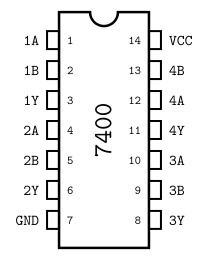

| | 5400 |
|---|---|
| Manufacturer | National Semiconductor |
| Date Code | 8020 |
| Decap Date | 2017-03-04 |
| Transistor Count | 16 |
| Package | Ceramic |
| Top Markings | [Logo] 8020 / DM5400J/8838 |
| Bottom Markings | 3A |
| Images | [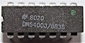](https://upload.wikimedia.org/wikipedia/commons/6/6c/Dm5400j-pack_top.jpg) [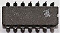](https://upload.wikimedia.org/wikipedia/commons/7/7e/Dm5400j-pack_bottom.jpg) [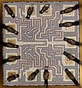](https://upload.wikimedia.org/wikipedia/commons/3/30/National_semiconductor_dm5400j_8838_die_image.jpg) [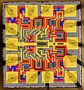](https://upload.wikimedia.org/wikipedia/commons/0/08/National_semiconductor_dm5400j_8838_die_image_annotated.jpg) [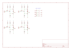](https://upload.wikimedia.org/wikipedia/commons/c/cb/5400_NS_8838_schematic.png) |
| Files | [KiCad](kicad/5400%20NS%208838%20schematic) [PDF](pdf/National_semiconductor_dm5400j_8838_schematic.pdf) [SVG](svg/5400%20NS%208838.svg) [datasheet](datasheet/5400_NS_datasheet.pdf) |

| | 5400 |
|---|---|
| Manufacturer | Texas Instruments |
| Date Code | 0421 |
| Decap Date | 2017-05-21 |
| Transistor Count | 16 |
| Package | Ceramic |
| Top Markings | 0ACS 0421A / SN5400J / THA [Logo] |
| Images | [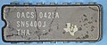](https://upload.wikimedia.org/wikipedia/commons/f/f1/5400_TI_0421_package_top.jpg) [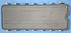](https://upload.wikimedia.org/wikipedia/commons/9/91/5400_TI_0421_package_bottom.jpg) [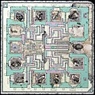](https://upload.wikimedia.org/wikipedia/commons/5/53/5400_TI_0421_die_120nmpp.jpg) [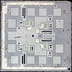](https://upload.wikimedia.org/wikipedia/commons/d/df/5400_TI_0421_delayer_120nmpp.jpg) [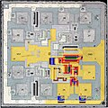](https://upload.wikimedia.org/wikipedia/commons/a/a2/5400_TI_0421_annotated_120nmpp.jpg) [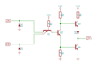](https://upload.wikimedia.org/wikipedia/commons/2/23/5400_TI_0421_schematic.png) |
| Files | [KiCad](kicad/5400%20TI%200421%20schematic) [PDF](pdf/5400_TI_0421_schematic.pdf) [SVG](svg/5400%20TI%200421%20annotated%20120nmpp.svg) [datasheet](datasheet/5400_TI_datasheet.pdf) |

| | 7400 |
|---|---|
| Manufacturer | National Semiconductor |
| Date Code | 443 |
| Decap Date | 2017-08-19 |
| Package | Plastic |
| Top Markings | [Logo] 443 / DM7400N |
| Bottom Markings | g |
| Images | [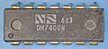](https://upload.wikimedia.org/wikipedia/commons/6/6e/7400_NS_443_package_top.jpg) [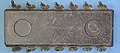](https://upload.wikimedia.org/wikipedia/commons/c/c1/7400_NS_443_package_bottom.jpg) [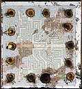](https://upload.wikimedia.org/wikipedia/commons/f/f8/7400_NS_443_die_120nmpp.jpg) |
| Files | [datasheet](datasheet/7400_NS_datasheet.pdf) |

| | 7400 |
|---|---|
| Manufacturer | Stewart-Warner |
| Date Code | 7413 |
| Decap Date | 2017-08-19 |
| Package | Plastic |
| Top Markings | SW 7400-N / 7413 |
| Bottom Markings | (illegible, but most likely "Philippines") |
| IC Donated By | Ken Shirriff |
| Images | [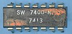](https://upload.wikimedia.org/wikipedia/commons/9/9f/7400_SW_7413_package_top.jpg) [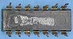](https://upload.wikimedia.org/wikipedia/commons/7/7f/7400_SW_7413_package_bottom.jpg) [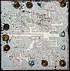](https://upload.wikimedia.org/wikipedia/commons/2/2e/7400_SW_7413_die_120nmpp.jpg) |

| | 54S00 |
|---|---|
| Manufacturer | Signetics |
| Date Code | 8716 |
| Decap Date | 2017-03-20 |
| Transistor Count | 20 |
| Package | Ceramic |
| Top Markings | [Logo] 54S00/ BCA / 8716 DKB THAI / [pin 1 delta marker] |
| Images | [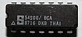](https://upload.wikimedia.org/wikipedia/commons/b/b8/54s00-pack_top.jpg) [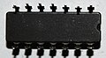](https://upload.wikimedia.org/wikipedia/commons/c/cb/54s00-pack_bottom.jpg) [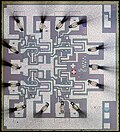](https://upload.wikimedia.org/wikipedia/commons/d/de/Signetics_54S00_8716_die_image.jpg) [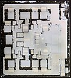](https://upload.wikimedia.org/wikipedia/commons/b/b4/Signetics_54S00_8716_die_image_delayered.jpg) [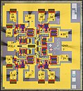](https://upload.wikimedia.org/wikipedia/commons/1/15/Signetics_54S00_8716_die_image_annotated.jpg) [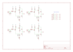](https://upload.wikimedia.org/wikipedia/commons/5/56/54S00_Signetics_8716_schematic.png) |
| Files | [KiCad](kicad/54S00%20SIG%208716%20schematic) [PDF](pdf/Schematic_for_Signetics_54S00_datecode_8716.pdf) [SVG](svg/54S00%20Signetics%208716.svg) [datasheet](datasheet/54S00_Signetics_datasheet.pdf) |

| | 54AS00 |
|---|---|
| Manufacturer | Texas Instruments |
| Date Code | 8747 |
| Decap Date | 2017-03-19 |
| Package | Ceramic |
| Top Markings | TAIWAN 8747 / SN54AS00J [Logo] / [Pin 1 delta marker] |
| Bottom Markings | JAX |
| Images | [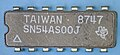](https://upload.wikimedia.org/wikipedia/commons/1/13/TI_54AS00_pack_top.jpg) [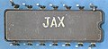](https://upload.wikimedia.org/wikipedia/commons/6/6d/TI_54AS00_pack_bottom.jpg) [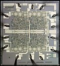](https://upload.wikimedia.org/wikipedia/commons/c/c5/Texas_Instruments_SN54AS00J_8747_die_image.jpg) [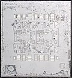](https://upload.wikimedia.org/wikipedia/commons/0/0b/54AS00_TI_8747_delayer2.jpg) [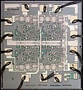](https://upload.wikimedia.org/wikipedia/commons/4/4a/Texas_Instruments_SN54AS00J_8747_die_image_minus_top_glass.jpg) |
| Files | [datasheet](datasheet/54AS00_TI_datasheet.pdf) |

| | 74F00 |
|---|---|
| Manufacturer | Fairchild |
| Date Code | 8423 |
| Decap Date | 2017-07-22 |
| Package | Plastic |
| Top Markings | 74F00 PC / [Logo] / 8423 USA |
| Images | [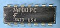](https://upload.wikimedia.org/wikipedia/commons/9/97/74F00_F_8423_package_top.jpg) [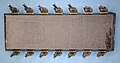](https://upload.wikimedia.org/wikipedia/commons/a/aa/74F00_F_8423_package_bottom.jpg) [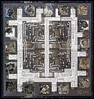](https://upload.wikimedia.org/wikipedia/commons/9/93/74F00_F_8423_die_120nmpp.jpg) [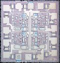](https://upload.wikimedia.org/wikipedia/commons/3/3e/74F00_F_8423_delayer_120nmpp.jpg) |
| Files | [datasheet](datasheet/74F00_Fairchild_datasheet.pdf) |

| | 74F00 |
|---|---|
| Manufacturer | Motorola |
| Date Code | 8352 |
| Decap Date | 2017-07-22 |
| Package | Plastic |
| Top Markings | MC74F00N / [Logo] I8352 |
| Bottom Markings | F00 KOREA / PYCJ1 |
| Images | [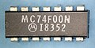](https://upload.wikimedia.org/wikipedia/commons/c/c3/74F00_Moto_8352_package_top.jpg) [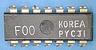](https://upload.wikimedia.org/wikipedia/commons/3/36/74F00_Moto_8352_package_bottom.jpg) [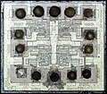](https://upload.wikimedia.org/wikipedia/commons/4/4f/74F00_Moto_8352_die_120nmpp.jpg) [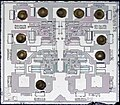](https://upload.wikimedia.org/wikipedia/commons/c/c6/74F00_Moto_8352_delayer_120nmpp.jpg) |
| Files | [datasheet](datasheet/74F00_Motorola_datasheet.pdf) |

| | 54HC00 |
|---|---|
| Manufacturer | National Semiconductor |
| Date Code | 8632 |
| Decap Date | 2017-10-18 |
| Package | Ceramic |
| Top Markings | [Logo] H8632[delta] / MM54HC00J/883C / 8403701CA 27104 |
| Bottom Markings | LK3/H / /J2 |
| Images | [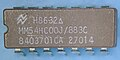](https://upload.wikimedia.org/wikipedia/commons/f/f2/54HC00_NS_8632_package_top.jpg) [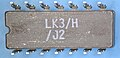](https://upload.wikimedia.org/wikipedia/commons/8/8c/54HC00_NS_8632_package_bottom.jpg) [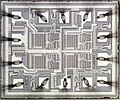](https://upload.wikimedia.org/wikipedia/commons/9/99/54HC00_NS_8632_die_120nmpp.jpg) |

| | 74HCT00 |
|---|---|
| Manufacturer | Radio Corporation of America |
| Date Code | 419 |
| Decap Date | 2017-08-19 |
| Package | Plastic |
| Top Markings | CD74HCT00E / RCA H 419 |
| Bottom Markings | 7AHER / B7300 |
| Images | [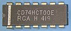](https://upload.wikimedia.org/wikipedia/commons/b/bc/74HCT00_RCA_419_package_top.jpg) [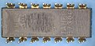](https://upload.wikimedia.org/wikipedia/commons/0/02/74HCT00_RCA_419_package_bottom.jpg) [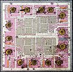](https://upload.wikimedia.org/wikipedia/commons/4/4b/74HCT00_RCA_419_die_120nmpp.jpg) |
| Files | [datasheet](datasheet/54HC00_RCA_datasheet.pdf) |

| | 74AC00 |
|---|---|
| Manufacturer | Fairchild |
| Date Code | 8703 |
| Decap Date | 2017-08-19 |
| Package | Plastic |
| Top Markings | 74AC00 PC / [Logo] / 8703 V SINGAPORE |
| Images | [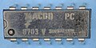](https://upload.wikimedia.org/wikipedia/commons/2/25/74AC00_F_8703_package_top.jpg) [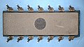](https://upload.wikimedia.org/wikipedia/commons/2/25/74AC00_F_8703_package_bottom.jpg) [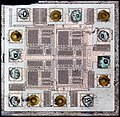](https://upload.wikimedia.org/wikipedia/commons/4/4d/74AC00_F_8703_die_120nmpp.jpg) |
| Files | [datasheet](datasheet/74AC00_Fairchild_datasheet.pdf) |
