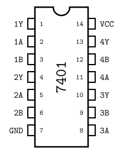
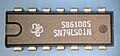
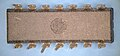
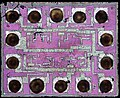
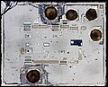
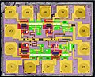
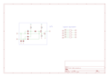

# 01 - quad 2-input NAND gate, open-collector

| | 74LS01 |
|---|---|
| Manufacturer | Texas Instruments |
| Date Code | 8610 |
| Decap Date | 2017-04-22 |
| Transistor Count | 8 |
| Package | Plastic |
| Top Markings | [Logo] S8610BS / SN74LS01N |
| Bottom Markings | 02 / SFAM / GO |
| Images |       |
| Files | [KiCad](kicad/74LS01%20TI%208610%20schematic) [PDF](pdf/74LS01_TI_8610_schematic.pdf) [SVG](svg/74LS01%20TI%208610%20annotated.svg) [datasheet](datasheet/74LS01_TI_datasheet.pdf) |
