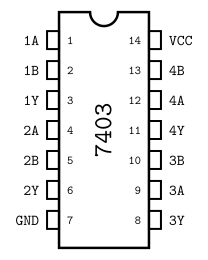
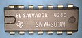
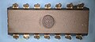
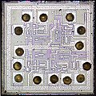
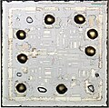

# 03 - quad 2-input NAND gate, open-collector

| | 74S03 |
|---|---|
| Manufacturer | Texas Instruments |
| Date Code | 428C |
| Decap Date | 2017-07-30 |
| Package | Plastic |
| Top Markings | EL SALVADOR 428C / [Logo] SN74S03N |
| Bottom Markings | C93 |
| Images |     |
| Files | [datasheet](datasheet/74S03_TI_datasheet.pdf) |
