### 04
( hex inverter gate )

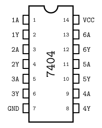

| | 5404 |
|---|---|
| Manufacturer | Texas Instruments |
| Date Code | 7426 |
| Decap Date | 2017-05-21 |
| Package | Ceramic |
| Top Markings | 7426 / [Logo] / SN5404J |
| Bottom Markings | 04AB 116W |
| Images | [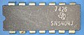](https://upload.wikimedia.org/wikipedia/commons/e/e6/5404_TI_7426_package_top.jpg) [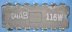](https://upload.wikimedia.org/wikipedia/commons/8/8d/5404_TI_7426_package_bottom.jpg) [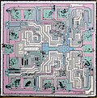](https://upload.wikimedia.org/wikipedia/commons/4/46/5404_TI_7426_die_120nmpp.jpg) |
| Files | [datasheet](datasheet/5404_TI_datasheet.pdf) |

| | 7404 |
|---|---|
| Manufacturer | Texas Instruments |
| Date Code | 8005 |
| Decap Date | 2017-05-13 |
| Package | Ceramic |
| Top Markings | TAIWAN 8005 / [Logo] / SN7404J |
| Bottom Markings | F5 |
| Images | [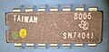](https://upload.wikimedia.org/wikipedia/commons/0/07/7404_TI_8005_package_top.jpg) [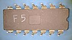](https://upload.wikimedia.org/wikipedia/commons/5/51/7404_TI_8005_package_bottom.jpg) [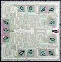](https://upload.wikimedia.org/wikipedia/commons/d/d3/7404_TI_8005_die_120nmpp.jpg) |
| Files | [datasheet](datasheet/7404_TI_datasheet.pdf) |

| | 74L04 |
|---|---|
| Manufacturer | Unknown |
| Date Code | 7608 |
| Decap Date | 2017-03-25 |
| Transistor Count | 24 |
| Package | Ceramic |
| Top Markings | 74L04J / 7608 |
| IC Donated By | Ken Shirriff |
| Images | [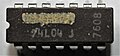](https://upload.wikimedia.org/wikipedia/commons/7/7c/74L04_UNK_7608_package_top.jpg) [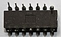](https://upload.wikimedia.org/wikipedia/commons/0/0f/74L04_UNK_7608_package_bottom.jpg) [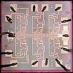](https://upload.wikimedia.org/wikipedia/commons/f/f5/74L04_UNK_7608.jpg) [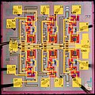](https://upload.wikimedia.org/wikipedia/commons/a/ab/74L04_UNK_7608_annotated.jpg) [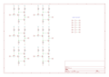](https://upload.wikimedia.org/wikipedia/commons/c/cc/74L04_UNK_7608_schematic.png) |
| Files | [KiCad](kicad/74L04%20UNK%207608%20schematic) [PDF](pdf/74L04_UNK_7608_schematic.pdf) [SVG](svg/74L04%20UNK%207608.svg) |

| | 54AS04 |
|---|---|
| Manufacturer | Texas Instruments |
| Date Code | 8737 |
| Decap Date | 2017-09-17 |
| Package | Ceramic |
| Top Markings | TAIWAN 8737 / SN54AS04J [Logo] / [pin 1 marker] |
| Bottom Markings | SLT |
| Images | [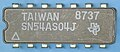](https://upload.wikimedia.org/wikipedia/commons/5/51/54AS04_TI_8737_package_top.jpg) [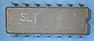](https://upload.wikimedia.org/wikipedia/commons/9/90/54AS04_TI_8737_package_bottom.jpg) [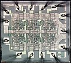](https://upload.wikimedia.org/wikipedia/commons/9/96/54AS04_TI_8737_die_120nmpp.jpg) |
| Files | [datasheet](datasheet/54AS04_TI_datasheet.pdf) |
