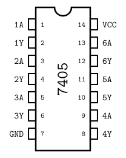
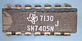
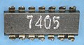
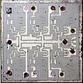
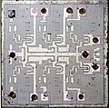
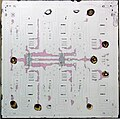
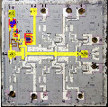
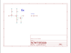

# 05 - hex inverter gate, open-collector

| | 7405 |
|---|---|
| Manufacturer | Texas Instruments |
| Date Code | 7130 |
| Decap Date | 2017-07-30 |
| Package | Plastic |
| Top Markings | [Logo] 7130 J / SN7405N |
| Bottom Markings | 7405 |
| Decap By | Robert C. Baruch |
| Annotated By | Ivo van Poorten |
| Images |        |
| Files | [KiCad](kicad/7405%20TI%207130%20schematic) [PDF](pdf/7405_TI_7130_schematic.pdf) [SVG](svg/7405%20TI%207130.svg) [datasheet](datasheet/7405_TI_datasheet.pdf) |
