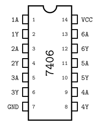
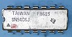
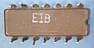
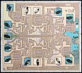
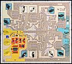
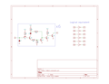

# 06 - hex inverter gate, open-collector

| | 5406 |
|---|---|
| Manufacturer | Texas Instruments |
| Date Code | 8615 |
| Decap Date | 2017-05-06 |
| Transistor Count | 30 |
| Package | Ceramic |
| Top Markings | TAIWAN F8615 / SN5406J [Logo] / [Pin 1 Marker] |
| Bottom Markings | EIB |
| Images |       |
| Files | [KiCad](kicad/5406%20TI%208615%20schematic) [PDF](pdf/5406_TI_8615_schematic.pdf) [SVG](svg/5406%20TI%208615%20annotated.svg) [datasheet](datasheet/5406_TI_datasheet.pdf) |
