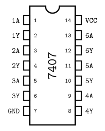
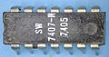
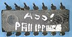
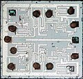

# 07 - hex buffer gate, open-collector

| | 7407 |
|---|---|
| Manufacturer | Stewart-Warner |
| Date Code | 7405 |
| Decap Date | 2017-08-13 |
| Package | Plastic |
| Top Markings | SW / 7407-N / 7405 |
| Bottom Markings | ASSY / PHILIPPINES |
| IC Donated By | Ken Shirriff |
| Images |    |
