# 08 - quad 2-input AND gate

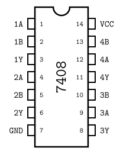

| | 5408 |
|---|---|
| Manufacturer | National Semiconductor |
| Date Code | 9911 |
| Decap Date | 2017-05-21 |
| Package | Ceramic |
| Top Markings | [Logo]H6C9911BΔ / DM5408J/883 / QS |
| Bottom Markings | 03 |
| Images | [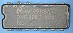](https://upload.wikimedia.org/wikipedia/commons/9/94/5408_NS_9911_package_top.jpg) [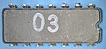](https://upload.wikimedia.org/wikipedia/commons/8/84/5408_NS_9911_package_bottom.jpg) [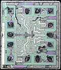](https://upload.wikimedia.org/wikipedia/commons/2/29/5408_NS_9911_die_120nmpp.jpg) |
| Files | [datasheet](datasheet/5408_NS_datasheet.pdf) |

| | 74H08 |
|---|---|
| Manufacturer | National Semiconductor |
| Date Code | 411 |
| Decap Date | 2017-03-28 |
| Transistor Count | 28 |
| Package | Plastic |
| Top Markings | [Logo] 411 / DM74H08N |
| Bottom Markings | g |
| Images | [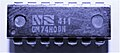](https://upload.wikimedia.org/wikipedia/commons/8/8e/74H08_NS_411_package_top.jpg) [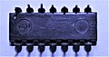](https://upload.wikimedia.org/wikipedia/commons/7/76/74H08_NS_411_package_bottom.jpg) [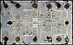](https://upload.wikimedia.org/wikipedia/commons/5/5b/74H08_NS_411.jpg) [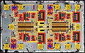](https://upload.wikimedia.org/wikipedia/commons/9/92/74H08_NS_411_annotated.jpg) [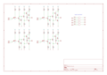](https://upload.wikimedia.org/wikipedia/commons/a/ae/74H08_NS_411_schematic.png) |
| Files | [KiCad](kicad/74H08%20NS%20411%20schematic) [PDF](pdf/74H08_NS_411_schematic.pdf) [SVG](svg/74H08%20NS%20411.svg) [datasheet](datasheet/74H08_NS_datasheet.pdf) |

| | 74LS08 |
|---|---|
| Manufacturer | Texas Instruments |
| Date Code | 8022 |
| Decap Date | 2017-05-13 |
| Transistor Count | 24 |
| Package | Ceramic |
| Top Markings | TAIWAN 8022 BG / [Logo] / 1 SN74LS08J |
| Bottom Markings | P33 |
| IC Donated By | Ken Shirriff |
| Images | [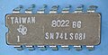](https://upload.wikimedia.org/wikipedia/commons/c/c8/74LS08_TI_8022_package_top.jpg) [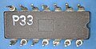](https://upload.wikimedia.org/wikipedia/commons/0/0d/74LS08_TI_8022_package_bottom.jpg) [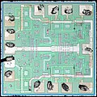](https://upload.wikimedia.org/wikipedia/commons/7/77/74LS08_TI_8022_die_120nmpp.jpg) [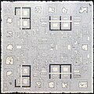](https://upload.wikimedia.org/wikipedia/commons/3/38/74LS08_TI_8022_delayer_120nmpp.jpg) [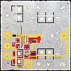](https://upload.wikimedia.org/wikipedia/commons/a/a4/74LS08_TI_8022_annotated_120nmpp.jpg) [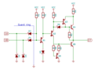](https://upload.wikimedia.org/wikipedia/commons/5/53/74LS08_TI_8022_schematic.png) |
| Files | [KiCad](kicad/74LS08%20TI%208022%20schematic) [PDF](pdf/74LS08_TI_8022_schematic.pdf) [SVG](svg/74LS08%20TI%208022%20annotated%20inkscape.svg) [datasheet](datasheet/74LS08_TI_datasheet.pdf) |

| | 54AS08 |
|---|---|
| Manufacturer | Texas Instruments |
| Date Code | 8418 |
| Decap Date | 2017-09-17 |
| Package | Ceramic |
| Top Markings | TAIWAN 8418 / SNJ54AS08J [Logo] / [pin 1 marker]54AS08/BCAJC |
| Bottom Markings | AGN |
| Images | [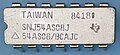](https://upload.wikimedia.org/wikipedia/commons/f/f4/54AS08_TI_8418_package_top.jpg) [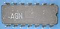](https://upload.wikimedia.org/wikipedia/commons/9/91/54AS08_TI_8418_package_bottom.jpg) [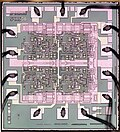](https://upload.wikimedia.org/wikipedia/commons/b/bf/54AS08_TI_8418_die_120nmpp.jpg) |
| Files | [datasheet](datasheet/54AS08_TI_datasheet.pdf) |
