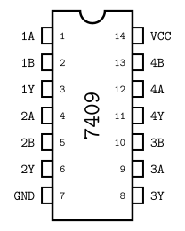
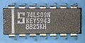
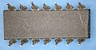
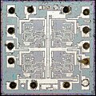

# 09 - quad 2-input AND gate, open-collector

| | 74LS09 |
|---|---|
| Manufacturer | Signetics |
| Date Code | 8825 |
| Decap Date | 2017-08-13 |
| Package | Plastic |
| Top Markings | [Logo] 74LS09N / KEY5943 / 8825KH |
| Images |    |
| Files | [datasheet](datasheet/74LS09_Signetics_datasheet.pdf) |
