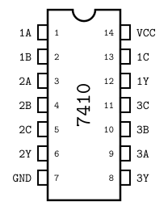
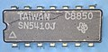
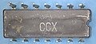
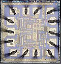
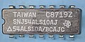
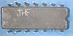
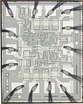

### 10
( triple 3-input NAND gate )

| | 5410 |
|---|---|
| Manufacturer | Texas Instruments |
| Date Code | 8850 |
| Decap Date | 2017-10-19 |
| Package | Ceramic |
| Top Markings | TAIWAN C8850 / SN5410J [Logo] / [pin 1 marker] |
| Bottom Markings | CCX |
| Images |    |
| Files | [datasheet](datasheet/5410_TI_datasheet.pdf) |

| | 54ALS10 |
|---|---|
| Manufacturer | Texas Instruments |
| Date Code | 8719 |
| Decap Date | 2017-11-04 |
| Package | Ceramic |
| Top Markings | TAIWAN C8719Z / SNJ54ALS10AJ [Logo] / [Pin 1 marker]54ALS10A/BCAJC |
| Bottom Markings | JHF |
| Images |    |
| Files | [datasheet](datasheet/54ALS10_TI_datasheet.pdf) |
