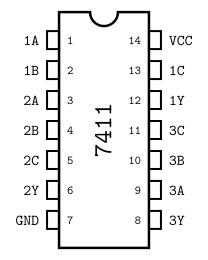
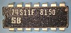
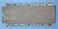
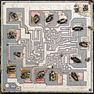
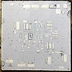
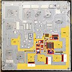
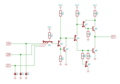

### 11
( triple 3-input AND gate )

| | 74S11 |
|---|---|
| Manufacturer | Signetics |
| Date Code | 8150 |
| Decap Date | 2017-05-21 |
| Transistor Count | 32 |
| Package | Ceramic |
| Top Markings | 74S11F 8150 / [Logo]B |
| Bottom Markings | 74S11 / GA4VC |
| Images |       |
| Files | [KiCad](kicad/74S11%20SIG%208150%20schematic) [PDF](pdf/74S11_SIG_8150_schematic.pdf) [SVG](svg/74S11%20SIG%208150%20annotated%20120nmpp.svg) [datasheet](datasheet/74S11_Signetics_datasheet.pdf) |
