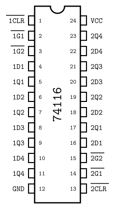
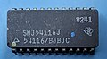
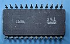
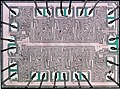

### 116
( dual 4-bit latch, clear )

| | 54116 |
|---|---|
| Manufacturer | Texas Instruments |
| Date Code | 8241 |
| Decap Date | 2017-11-23 |
| Package | Ceramic |
| Top Markings | 8241 / SNJ54116J [Logo] / [Pin 1 marker] 54116/BJBJC |
| Bottom Markings | 1168A / 341 / TAIWAN |
| Images |    |
| Files | [datasheet](datasheet/54116_TI_datasheet.pdf) |
