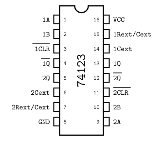
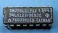
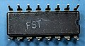
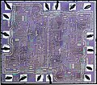

### 123
( dual retriggerable monostable multivibrator, clear )

| | 54LS123 |
|---|---|
| Manufacturer | Texas Instruments |
| Date Code | 8443 |
| Decap Date | 2017-11-26 |
| Package | Ceramic |
| Top Markings | SNJ54LS123J A 8443 / 54LS123/BEBJC [Logo] / [Pin 1 marker] 7603901EB TAIWAN |
| Bottom Markings | FST |
| Images |    |
| Files | [datasheet](datasheet/54LS123_TI_datasheet.pdf) |
