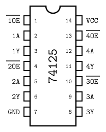
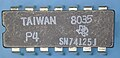
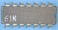
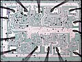
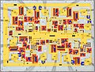
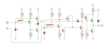

# 125 - quad bus buffer, negative enable, three-state

| | 74125 |
|---|---|
| Manufacturer | Texas Instruments |
| Date Code | 8035 |
| Decap Date | 2017-08-31 |
| Transistor Count | 48 |
| Package | Ceramic |
| Top Markings | TAIWAN 8035 / P4 [Logo] / SN74125J |
| Bottom Markings | 61N |
| Images |      |
| Files | [KiCad](kicad/74125%20TI%208035%20schematic) [PDF](pdf/74125_TI_8035_schematic.pdf) [SVG](svg/74125%20TI%208035%20annotated.svg) [datasheet](datasheet/74125_TI_datasheet.pdf) |
