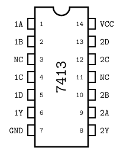
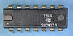
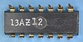
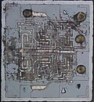
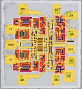
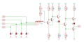

# 13 - dual 4-input NAND gate, Schmitt-trigger inputs

| | 7413 |
|---|---|
| Manufacturer | Texas Instruments |
| Date Code | 7348 |
| Decap Date | 2017-12-23 |
| Transistor Count | 14 |
| Package | Plastic |
| Top Markings | 7348 / [Logo] / SN7413N |
| Bottom Markings | 13AZ12 |
| Images |      |
| Files | [KiCad](kicad/7413%20TI%207348%20schematic) [PDF](pdf/7413_TI_7348_schematic.pdf) [SVG](svg/7413%20TI%207348%20die%20annotated%20120nmpp.svg) [datasheet](datasheet/7413_TI_datasheet.pdf) |
