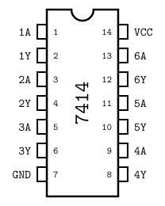
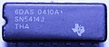
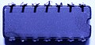
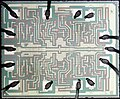
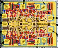
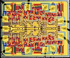
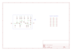

# 14 - hex inverter gate, Schmitt-trigger inputs

| | 5414 |
|---|---|
| Manufacturer | Texas Instruments |
| Date Code | 0410 |
| Decap Date | 2017-04-06 |
| Transistor Count | 28 |
| Package | Ceramic |
| Images |       |
| Files | [KiCad](kicad/5414%20TI%200410%20schematic) [PDF](pdf/5414_TI_0410_schematic.pdf) [SVG](svg/5414%20TI%200410%20annotated.svg) [datasheet](datasheet/5414_TI_datasheet.pdf) |
