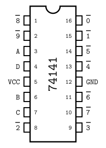
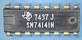
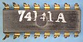
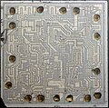
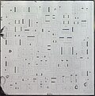
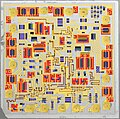
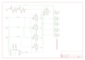

# 141 - BCD to decimal decoder/driver for cold-cathode indicator / Nixie tube, open-collector

| | 74141 |
|---|---|
| Manufacturer | Texas Instruments |
| Date Code | 7437 |
| Decap Date | 2017-07-01 |
| Transistor Count | 27 |
| Package | Plastic |
| Top Markings | [Logo] 7437 J / SN74141N |
| Bottom Markings | 74141A |
| Images |        |
| Files | [KiCad](kicad/74141%20TI%207437%20schematic) [PDF](pdf/74141_TI_7437_schematic.pdf) [SVG](svg/74141%20TI%207437%20annotated%20120nmpp.svg) [datasheet](datasheet/74141_TI_datasheet.pdf) |
