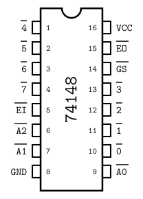
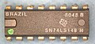
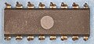
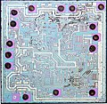
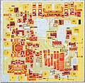
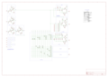

### 148
( 8-line to 3-line priority encoder )

| | 74LS148 |
|---|---|
| Manufacturer | Texas Instruments |
| Date Code | 8048 |
| Decap Date | 2017-09-09 |
| Transistor Count | 83 |
| Package | Plastic |
| Top Markings | BRAZIL 8048B / [Logo] / SN74LS148N |
| Images |      |
| Files | [KiCad](kicad/74LS148%20TI%208048%20schematic) [PDF](pdf/74LS148_TI_8048_schematic.pdf) [SVG](svg/74LS148%20TI%208048%20die%20120nmpp%20annotated.svg) [datasheet](datasheet/74LS148_TI_datasheet.pdf) |
