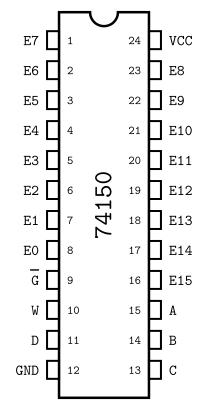
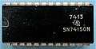
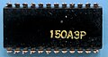
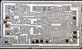

# 150 - 16-line to 1-line data selector/multiplexer

| | 74150 |
|---|---|
| Manufacturer | Texas Instruments |
| Date Code | 7413 |
| Decap Date | 2017-09-03 |
| Package | Plastic |
| Top Markings | 7413 / [Logo] / SN74150N |
| Bottom Markings | 150A3P |
| Images |    |
| Files | [datasheet](datasheet/74150_TI_datasheet.pdf) |
