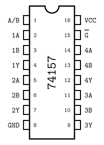
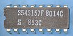
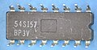
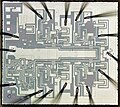

# 157 - quad 2-line to 1-line data selector/multiplexer, non-inverting outputs

| | 54S157 |
|---|---|
| Manufacturer | Signetics |
| Date Code | 8014 |
| Decap Date | 2017-10-31 |
| Package | Ceramic |
| Top Markings | S54S157F 8014C / [Logo] 883C |
| Bottom Markings | 54S157 / BP3V |
| Images |    |
| Files | [datasheet](datasheet/54S157_Signetics_datasheet.pdf) |
