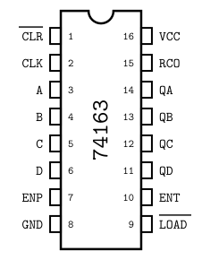
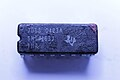
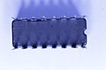
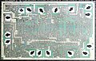
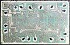
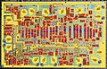
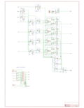

# 163 - synchronous presettable 4-bit binary counter, synchronous clear

| | 54163 |
|---|---|
| Manufacturer | Texas Instruments |
| Date Code | 0423 |
| Decap Date | 2017-04-08 |
| Transistor Count | 104 |
| Package | Ceramic |
| Top Markings | 7DBS 0423A / SN54163J [Logo] / THA |
| Images |        |
| Files | [KiCad](kicad/54163%20TI%200423%20schematic) [PDF](pdf/54163_TI_0423_schematic.pdf) [SVG](svg/54163%20TI%200423%20annotated.svg) [datasheet](datasheet/54163_TI_datasheet.pdf) |
