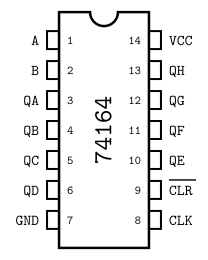
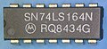
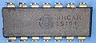
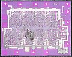

### 164
( 8-bit serial-in parallel-out (SIPO) shift register, asynchronous clear, not output latch )

| | 74LS164 |
|---|---|
| Manufacturer | Motorola |
| Date Code | 8434 |
| Decap Date | 2017-10-21 |
| Package | Plastic |
| Top Markings | SN74LS164N / [Logo] RQ8434G |
| Bottom Markings | ANJ / MALAYSIA / RHCAR / LS164 |
| IC Donated By | Mark Jeronimus |
| Images |    |
| Files | [datasheet](datasheet/74LS164_Motorola_datasheet.pdf) |
