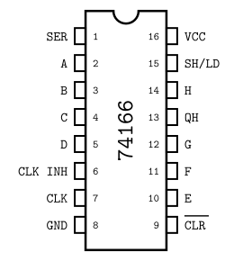
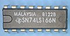
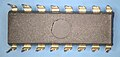
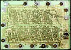

# 166 - parallel-load 8-bit shift register

| | 74LS166 |
|---|---|
| Manufacturer | Texas Instruments |
| Date Code | 8122 |
| Decap Date | 2017-08-27 |
| Package | Plastic |
| Top Markings | MALAYSIA 8122B / [Logo]SN74LS166N |
| Images |    |
| Files | [datasheet](datasheet/74LS166_TI_datasheet.pdf) |
