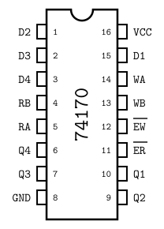
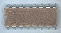
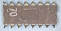
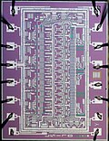

# 170 - 16-bit register file (4x4), open-collector

| | 54LS170 |
|---|---|
| Manufacturer | Unknown |
| Date Code | Unknown |
| Decap Date | 2018-05-12 |
| Package | Ceramic |
| Bottom Markings | 70 |
| Images |    |
