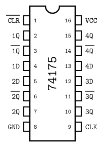
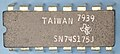
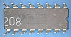
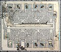
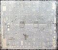
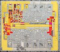
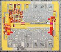
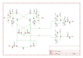

# 175 - quad D edge-triggered flip-flop, shared clock and asynchronous clear, Q & /Q outputs

| | 74S175 |
|---|---|
| Manufacturer | Texas Instruments |
| Date Code | 7939 |
| Decap Date | 2017-05-21 |
| Transistor Count | 100 |
| Package | Ceramic |
| Top Markings | TAIWAN 7939 / [Logo] / SN74S175J |
| Bottom Markings | 208 |
| Images |        |
| Files | [KiCad](kicad/74S175%20TI%207939%20schematic) [PDF](pdf/74S175_TI_7939_schematic.pdf) [SVG](svg/74S175%20TI%207939%20annotated.svg) [datasheet](datasheet/74S175_TI_datasheet.pdf) |
