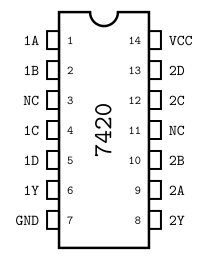
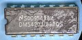
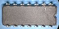
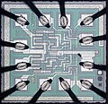

# 20 - dual 4-input NAND gate

| | 5420 |
|---|---|
| Manufacturer | National Semiconductor |
| Date Code | 8830 |
| Decap Date | 2017-12-31 |
| Package | Ceramic |
| Top Markings | [Logo]S0D9549AΔ / DM5420J/8830S |
| Images |    |
| Files | [KiCad](kicad/5420%20NS%208830%20schematic) [PDF](pdf/5420_NS_8830_schematic.pdf) [SVG](svg/5420%20NS%208830%20annotated.svg) [datasheet](datasheet/5420_NS_datasheet.pdf) |
