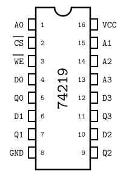
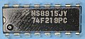
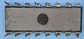
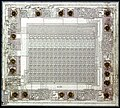
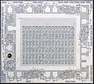

### 219
( 64-bit RAM (16x4), non-inverting outputs, three-state )

| | 74F219 |
|---|---|
| Manufacturer | National Semiconductor |
| Date Code | 8915 |
| Decap Date | 2017-07-19 |
| Package | Plastic |
| Top Markings | [Logo] MS8915JY / 74F219PC |
| Images |     |
| Files | [datasheet](datasheet/74F219_NS_datasheet.pdf) |
