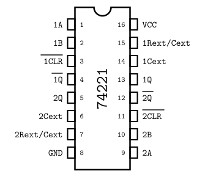
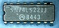
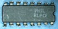
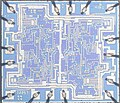
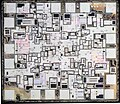

# 221 - dual monostable multivibrator

| | 74LS221 |
|---|---|
| Manufacturer | Motorola |
| Date Code | 8443 |
| Decap Date | 2018-11-17 |
| Package | Ceramic |
| Top Markings | SN74LS221J / [Logo] 8443 |
| Bottom Markings | PHIL / RLPCF |
| IC Donated By | Mark Jeronimus |
| Images |     |
| Files | [datasheet](datasheet/74LS221_Motorola_datasheet.pdf) |
