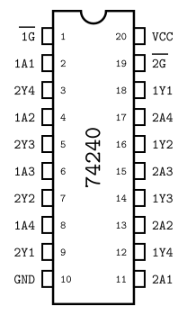
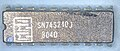
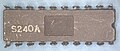
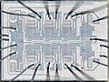

# 240 - octal buffer, inverting outputs, three-state

| | 74S240 |
|---|---|
| Manufacturer | Monolithic Memories, Inc. |
| Date Code | 8040 |
| Decap Date | 2018-07-15 |
| Package | Ceramic |
| Top Markings | [Logo] SN74S240J / 8040 |
| Bottom Markings | S240A |
| IC Donated By | Mark Jeronimus |
| Images |    |
| Files | [datasheet](datasheet/74S240_MMI_datasheet.pdf) |
