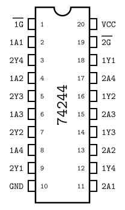
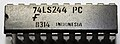
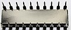
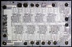
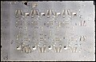
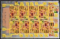
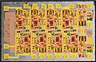
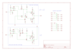

# 244 - octal buffer, non-inverting outputs, three-state

| | 74LS244 |
|---|---|
| Manufacturer | Fairchild |
| Date Code | 8314 |
| Decap Date | 2017-03-26 |
| Transistor Count | 80 |
| Package | Plastic |
| Images |        |
| Files | [KiCad](kicad/74LS244%20F%208314%20schematic) [PDF](pdf/74LS244_F_8314_schematic.pdf) [SVG](svg/74LS244%20F%208314%20annotated.svg) [datasheet](datasheet/74LS244_Fairchild_datasheet.pdf) |
