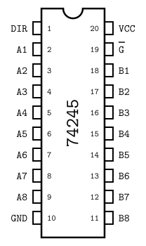
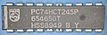
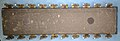
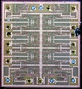

### 245
( octal bus transceiver, non-inverting outputs, three-state )

| | 74HCT245 |
|---|---|
| Manufacturer | Philips |
| Date Code | 8949 |
| Decap Date | 2017-05-27 |
| Package | Plastic |
| Top Markings | [Logo] PC74HCT245P / 654650T / HSS8949 B Y |
| IC Donated By | Mark Jeronimus |
| Images |    |
| Files | [datasheet](datasheet/74HCT245_Philips_datasheet.pdf) |
