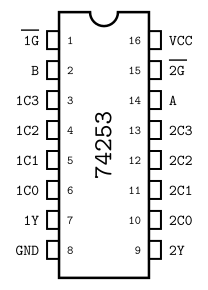
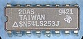
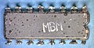
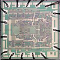

# 253 - dual 4-line to 1-line data selector/multiplexer, three-state

| | 54LS253 |
|---|---|
| Manufacturer | Texas Instruments |
| Date Code | 9421 |
| Decap Date | 2017-12-30 |
| Package | Ceramic |
| Top Markings | 2DAS 9421 / TAIWAN [Logo] / [Pin 1 marker]SN54LS253J |
| Bottom Markings | MBM |
| IC Donated By | Mark Jeronimus |
| Images |    |
| Files | [datasheet](datasheet/54LS253_TI_datasheet.pdf) |
