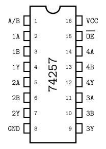
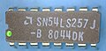
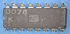
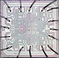

### 257
( quad 2-line to 1-line data selector/multiplexer, non-inverting outputs, three-state )

| | 54LS257 |
|---|---|
| Manufacturer | Advanced Micro Devices |
| Date Code | 8044 |
| Decap Date | 2017-10-30 |
| Package | Ceramic |
| Top Markings | [Logo] SN54LS257J / -B 8044DK |
| Bottom Markings | 0076 / K |
| Images |    |
| Files | [datasheet](datasheet/54LS257_AMD_datasheet.pdf) |
