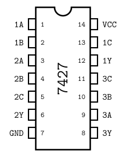
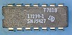
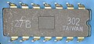

### 27
( triple 3-input NOR gate )

| | 5427 |
|---|---|
| Manufacturer | Texas Instruments |
| Date Code | 7818 |
| Decap Date | 2017-09-03 |
| Package | Ceramic |
| Top Markings | T7818 / 17239-1 [Logo] / SNJ5427 |
| Bottom Markings | 27B 302 / TAIWAN |
| Images |    |
| Files | [datasheet](datasheet/5427_TI_datasheet.pdf) |
