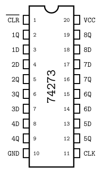
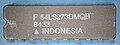
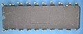
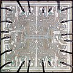

### 273
( 8-bit register, asynchronous clear )

| | 54LS273 |
|---|---|
| Manufacturer | Fairchild |
| Date Code | 8433 |
| Decap Date | 2017-11-20 |
| Package | Ceramic |
| Top Markings | F 54LS273DMQB / 8433 / [Triangle] INDONESIA |
| Images |    |
| Files | [datasheet](datasheet/54LS273_Fairchild_datasheet.pdf) |
