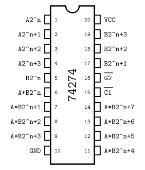
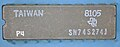
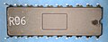
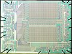

# 274 - 4-bit by 4-bit binary multiplier, three-state

| | 74S274 |
|---|---|
| Manufacturer | Texas Instruments |
| Date Code | 8105 |
| Decap Date | 2017-09-02 |
| Package | Ceramic |
| Top Markings | TAIWAN 8105 / [Logo] / P4 SN74S274J |
| Bottom Markings | R06 |
| Images |     |
| Files | [datasheet](datasheet/74S274_TI_datasheet.pdf) |
