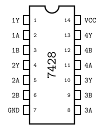
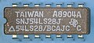
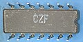
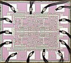

### 28
( quad 2-input NOR gate, driver )

| | 54LS28 |
|---|---|
| Manufacturer | Texas Instruments |
| Date Code | 8904 |
| Decap Date | 2017-09-04 |
| Package | Ceramic |
| Top Markings | TAIWAN A8904A / SNJ54LS28J [Logo] / [Pin 1 marker]54LS28/BCAJC C |
| Images |    |
| Files | [datasheet](datasheet/54LS28_TI_datasheet.pdf) |
