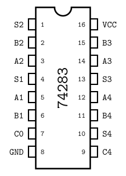
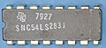
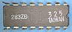
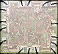

# 283 - 4-bit binary full adder (has carry in function)

| | 54LS283 |
|---|---|
| Manufacturer | Texas Instruments |
| Date Code | 7927 |
| Decap Date | 2017-09-03 |
| Package | Ceramic |
| Top Markings | [Logo] 7927 / SNC54LS283J |
| Bottom Markings | 283ZB 325 / TAIWAN |
| Images |    |
| Files | [datasheet](datasheet/54LS283_TI_datasheet.pdf) |
