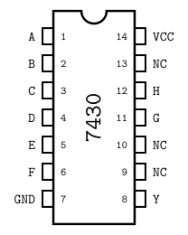
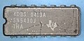
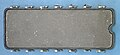
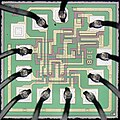
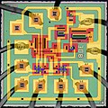
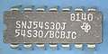
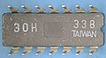
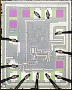

# 30 - single 8-input NAND gate

| | 5430 |
|---|---|
| Manufacturer | Texas Instruments |
| Date Code | 0413 |
| Decap Date | 2017-09-17 |
| Package | Ceramic |
| Top Markings | 4DBS 0413A / SN5430J / THA [Logo] |
| Images |     |
| Files | [SVG](svg/5430%20TI%200413%20annotated.svg) [datasheet](datasheet/5430_TI_datasheet.pdf) |

| | 54S30 |
|---|---|
| Manufacturer | Texas Instruments |
| Date Code | 8140 |
| Decap Date | 2017-09-04 |
| Package | Ceramic |
| Top Markings | 8140 / SNJ54S30J [Logo] / 54S30/BCBJC |
| Bottom Markings | 30H 338 / TAIWAN |
| Images |    |
| Files | [datasheet](datasheet/54S30_TI_datasheet.pdf) |
