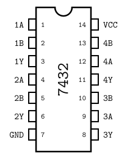
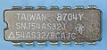
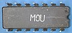
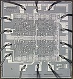
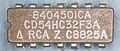
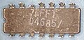
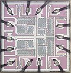

# 32 - quad 2-input OR gate

| | 54AS32 |
|---|---|
| Manufacturer | Texas Instruments |
| Date Code | 8704 |
| Decap Date | 2017-09-17 |
| Package | Ceramic |
| Top Markings | TAIWAN 8704Y / SNJ54AS32J [Logo] / [pin 1 marker]54AS32/BCAJC |
| Bottom Markings | M0U |
| Images |    |
| Files | [datasheet](datasheet/54AS32_TI_datasheet.pdf) |

| | 54HC32 |
|---|---|
| Manufacturer | Radio Corporation of America |
| Date Code | 8825 |
| Decap Date | 2018-01-06 |
| Package | Ceramic |
| Top Markings | 8404501CA / CD54HC32F3A / [Pin 1 marker] RCA Z C8825A |
| Bottom Markings | 7LFFT / D4685 |
| Images |    |
