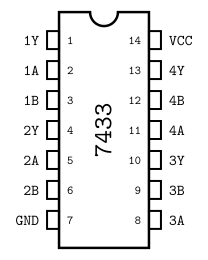
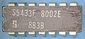
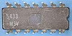
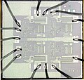

### 33
( quad 2-input NOR gate, open-collector driver )

| | 5433 |
|---|---|
| Manufacturer | Signetics |
| Date Code | 8002 |
| Decap Date | 2017-10-28 |
| Package | Ceramic |
| Top Markings | S5433F 8002E / [Logo] 883B |
| Bottom Markings | 5433 / -M3V |
| Images |    |
| Files | [datasheet](datasheet/5433_Signetics_datasheet.pdf) |
