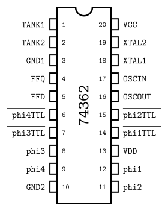
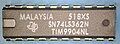
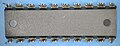
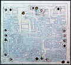

# 362 - four-phase clock generator/driver for Texas Instruments TMS9900

| | 74LS362 |
|---|---|
| Manufacturer | Texas Instruments |
| Date Code | 518 |
| Decap Date | 2017-06-03 |
| Package | Plastic |
| Top Markings | MALAYSIA 518XS / [Logo] SN74LS362N / TIM9904NL |
| Images |    |
| Files | [datasheet](datasheet/74LS362_TI_datasheet.pdf) |
