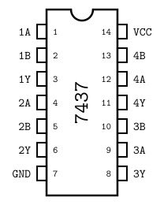
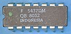
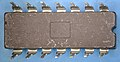
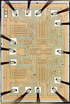
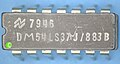
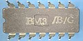
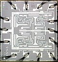

### 37
( quad 2-input NAND gate, driver )

| | 5437 |
|---|---|
| Manufacturer | Fairchild |
| Date Code | 8032 |
| Decap Date | 2017-10-29 |
| Package | Ceramic |
| Top Markings | F 5437DM / QB 8032 / INDONESIA |
| Images |    |
| Files | [datasheet](datasheet/5437_Fairchild_datasheet.pdf) |

| | 54LS37 |
|---|---|
| Manufacturer | National Semiconductor |
| Date Code | 7946 |
| Decap Date | 2017-08-30 |
| Package | Ceramic |
| Top Markings | [Logo] 7946 / DM54LS37J/883B |
| Bottom Markings | BM3 /B/G |
| Images |    |
| Files | [datasheet](datasheet/54LS37_NS_datasheet.pdf) |
