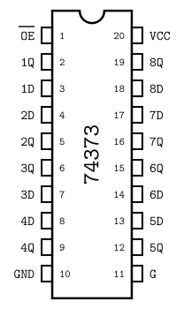
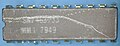
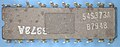
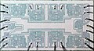

### 373
( octal transparent latch, three-state )

| | 74S373 |
|---|---|
| Manufacturer | Monolithic Memories, Inc. |
| Date Code | 7949 |
| Decap Date | 2017-08-29 |
| Package | Ceramic |
| Top Markings | SN74S373J / MMI 7949 |
| Bottom Markings | 54S373A / B7948 / (inverted)S373A |
| Images |    |
| Files | [datasheet](datasheet/74S373_MMI_datasheet.pdf) |
