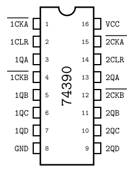
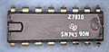
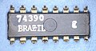
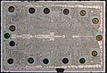

# 390 - dual 4-bit decade counter, asynchronous clear

| | 74390 |
|---|---|
| Manufacturer | Texas Instruments |
| Date Code | 7810 |
| Decap Date | 2019-05-11 |
| Package | Plastic |
| Top Markings | Z7810 / [Logo] / SN74390N |
| Bottom Markings | 74390 / BRAZIL / E |
| IC Donated By | Mark Jeronimus |
| Images |    |
| Files | [datasheet](datasheet/74390_TI_datasheet.pdf) |
