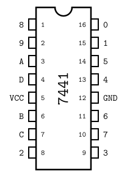
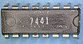
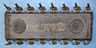
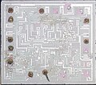

# 41 - BCD to decimal decoder / Nixie tube driver, open-collector

| | 7441 |
|---|---|
| Manufacturer | Unknown |
| Date Code | Unknown |
| Decap Date | 2017-10-22 |
| Package | Plastic |
| IC Donated By | Ken Shirriff |
| Images |    |
