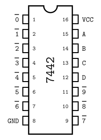
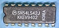
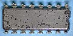
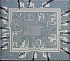

# 42 - BCD to decimal decoder

| | 54LS42 |
|---|---|
| Manufacturer | Motorola |
| Date Code | 9402 |
| Decap Date | 2018-01-01 |
| Package | Ceramic |
| Top Markings | [Logo]SN54LS42J / KKEV9402 / KOREA |
| IC Donated By | Mark Jeronimus |
| Images |    |
| Files | [datasheet](datasheet/54LS42_Motorola_datasheet.pdf) |
