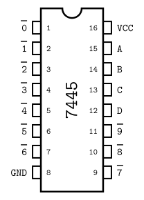
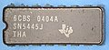
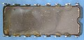

# 45 - BCD to decimal decoder/driver, open-collector

| | 5445 |
|---|---|
| Manufacturer | Texas Instruments |
| Date Code | 0404 |
| Decap Date | 2017-09-02 |
| Package | Ceramic |
| Top Markings | 6CBS 0404A / SN5445J / THA [Logo] |
| Images |    |
| Files | [datasheet](datasheet/5445_TI_datasheet.pdf) |
