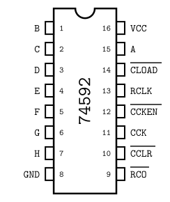
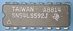
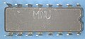
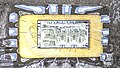
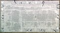

### 592
( 8-bit binary counter, input registers )

| | 54LS592 |
|---|---|
| Manufacturer | Texas Instruments |
| Date Code | 8814 |
| Decap Date | 2017-08-28 |
| Package | Ceramic |
| Top Markings | TAIWAN A8814 / SN54LS592J [Logo] / [Pin 1 indicator] |
| Bottom Markings | MWU |
| Images |     |
| Files | [datasheet](datasheet/54LS592_TI_datasheet.pdf) |
